<style>
/* ============ "How LLMs Work" article styles (scoped to this post) ============ */
.post-container{--ink:#1a202c;--muted:#59637a;--line:#e7e9f0;--accent:#2b6cb0;}

/* reading progress bar */
.llm-progress{position:fixed;top:0;left:0;right:0;height:3px;z-index:9999;pointer-events:none;}
.llm-progress-bar{height:100%;width:0;background:linear-gradient(90deg,#2b6cb0,#63b3ed);}

/* floating back-to-contents */
.llm-top{position:fixed;right:18px;bottom:18px;z-index:9998;width:46px;height:46px;border-radius:50%;
  background:#1a202c;color:#fff!important;display:flex;align-items:center;justify-content:center;
  font-size:19px;line-height:1;box-shadow:0 5px 18px rgba(0,0,0,.22);opacity:.88;}
.llm-top:hover{opacity:1;border-bottom:0!important;transform:translateY(-2px);}

/* hero */
.llm-hero{border:1px solid var(--line);border-left:4px solid var(--accent);border-radius:10px;
  padding:22px 24px;margin:8px 0 30px;background:linear-gradient(180deg,#fbfcfe,#f6f8fc);}
.llm-hero p{margin:0 0 12px;color:var(--ink);}
.llm-hero p:last-child{margin-bottom:0;}
.llm-stats{display:flex;flex-wrap:wrap;gap:8px;margin-top:16px;}
.llm-stat{background:#fff;border:1px solid var(--line);border-radius:999px;padding:5px 13px;
  font-size:14px;color:var(--muted);white-space:nowrap;}
.llm-stat b{color:var(--ink);}

/* table of contents cards */
.llm-toc{display:grid;grid-template-columns:repeat(auto-fill,minmax(215px,1fr));gap:12px;margin:24px 0 8px;}
.llm-toc-card{display:block;border:1px solid var(--line);border-radius:10px;padding:14px 15px 15px;
  background:#fff;color:var(--ink)!important;transition:box-shadow .18s ease,transform .18s ease,border-color .18s ease;}
.llm-toc-card:hover{border-bottom:1px solid var(--accent)!important;border-color:#bcd3ea;
  box-shadow:0 6px 18px rgba(26,32,44,.09);transform:translateY(-2px);}
.llm-toc-num{display:inline-block;font-size:12px;font-weight:700;letter-spacing:.10em;
  color:var(--accent);background:#eaf2fb;border-radius:5px;padding:2px 7px;margin-bottom:9px;}
.llm-toc-title{display:block;font-weight:700;font-size:17px;line-height:1.3;margin-bottom:6px;}
.llm-toc-desc{display:block;font-size:14px;line-height:1.5;color:var(--muted);}

/* reading paths */
.llm-paths{display:grid;grid-template-columns:repeat(auto-fit,minmax(210px,1fr));gap:12px;margin:20px 0;}
.llm-path{border:1px solid var(--line);border-radius:10px;padding:15px 16px;background:#fff;}
.llm-path h4{margin:0 0 9px;font-size:16px;font-weight:700;color:var(--ink);line-height:1.3;}
.llm-path p{margin:0;font-size:14px;line-height:1.6;color:var(--muted);}
.llm-path a{color:var(--accent)!important;font-weight:600;}

/* chapter eyebrow + heading */
.llm-mark{display:flex;align-items:center;gap:12px;margin:64px 0 -6px;}
.llm-mark span{font-size:12px;font-weight:700;letter-spacing:.16em;text-transform:uppercase;
  color:var(--accent);background:#eaf2fb;border-radius:5px;padding:4px 10px;white-space:nowrap;}
.llm-mark:after{content:"";flex:1;height:1px;background:var(--line);}
.post-container h2{scroll-margin-top:20px;margin-top:14px;}
.post-container h3{scroll-margin-top:20px;margin-top:34px;font-size:21px;}
.post-container h4{scroll-margin-top:20px;margin-top:26px;font-weight:700;font-size:18px;}

/* chapter footer nav */
.llm-nav{display:flex;flex-wrap:wrap;justify-content:space-between;gap:10px;
  border-top:1px solid var(--line);margin-top:34px;padding-top:14px;font-size:15px;}
.llm-nav a{color:var(--accent)!important;font-weight:600;}

/* callouts */
.llm-note{border-radius:8px;padding:14px 17px;margin:20px 0;font-size:16px;line-height:1.62;}
.llm-note p{margin:0 0 9px;}
.llm-note p:last-child,.llm-note ul:last-child,.llm-note ol:last-child{margin-bottom:0;}
.llm-note b:first-child,.llm-note strong:first-child{letter-spacing:.01em;}
.llm-analogy{background:#fffbf0;border-left:4px solid #dd9a2e;}
.llm-idea{background:#eef6fd;border-left:4px solid #3182ce;}
.llm-example{background:#f9f5ff;border-left:4px solid #805ad5;}
.llm-warn{background:#fff5f5;border-left:4px solid #e53e3e;}
.llm-run{background:#f0fdf6;border-left:4px solid #2f9e5f;}
.llm-run b:first-child{color:#1c6b41;}
.llm-run code{background:#dcf5e6;padding:1px 5px;border-radius:4px;font-size:14px;}

/* formula plate */
.llm-formula{background:#1a202c;color:#e9edf5;border-radius:8px;padding:16px 18px;margin:20px 0;
  font-family:Consolas,Menlo,monospace;font-size:16px;line-height:1.7;text-align:center;overflow-x:auto;}
.llm-formula em{color:#90cdf4;font-style:normal;}
.llm-formula small{display:block;margin-top:9px;font-size:13px;color:#9aa5b8;font-family:'Nunito Sans',sans-serif;}

/* key takeaways */
.llm-takeaways{background:#f2fbf5;border:1px solid #cceedb;border-left:4px solid #38a169;
  border-radius:8px;padding:6px 20px 16px;margin:32px 0 0;}
.llm-takeaways h4{margin:16px 0 8px;font-size:16px;font-weight:700;color:#22543d;
  letter-spacing:.05em;text-transform:uppercase;}
.llm-takeaways ul{margin:0;padding-left:20px;}
.llm-takeaways li{margin-bottom:7px;line-height:1.6;}
.llm-takeaways li:last-child{margin-bottom:0;}

/* mermaid diagram frame */
.post-container code.language-mermaid{display:block;background:#fcfcfe;border:1px solid var(--line);
  border-radius:10px;padding:22px 14px;text-align:center;overflow-x:auto;font-size:14px;}
.post-container code.language-mermaid svg{max-width:100%;height:auto;}
.post-container pre{margin:22px 0;}

/* glossary */
.llm-alpha{display:flex;flex-wrap:wrap;gap:7px;margin:18px 0 26px;}
.llm-alpha a{display:inline-block;min-width:34px;text-align:center;border:1px solid var(--line);
  border-radius:7px;padding:5px 9px;font-weight:700;color:var(--accent)!important;background:#fff;}
.llm-alpha a:hover{background:#eaf2fb;border-bottom:1px solid var(--line)!important;}
.llm-gloss dt{font-weight:700;margin-top:13px;}
.llm-gloss dd{margin:3px 0 0;color:var(--muted);}

/* tables read better tight */
.post-container table{width:100%;font-size:15px;}
.post-container th{background:#f6f8fc;text-align:left;}

@media screen and (max-width:540px){
  .llm-toc{grid-template-columns:1fr;}
  .llm-mark{margin-top:48px;}
  .llm-top{width:40px;height:40px;right:12px;bottom:12px;}
}
</style>

<div class="llm-progress"><div class="llm-progress-bar" id="llmProgress"></div></div>
<a href="#contents" class="llm-top" title="Back to contents">&uarr;</a>

<div class="llm-hero">
  <p>Everyone uses large language models now. Far fewer people can say what actually happens between "I typed a question" and "words appeared." This guide answers that, end to end, in the order a real model is built.</p>
  <p>No hand-waving and no heavy math prerequisites. Every stage gets the same treatment: <b>intuition, then a diagram, then the algorithm, then a worked example you can follow by hand.</b> Then every chapter ends with a <b>Build it</b> section of real, runnable code, so by the end you will have trained a tokenizer, written a GPT, pretrained it, fine-tuned a real model with LoRA, aligned it with DPO, benchmarked it, and served it.</p>
  <div class="llm-stats">
    <span class="llm-stat"><b>9</b> chapters</span>
    <span class="llm-stat"><b>56</b> diagrams</span>
    <span class="llm-stat"><b>45+</b> code samples</span>
    <span class="llm-stat"><b>9</b> runnable builds</span>
    <span class="llm-stat"><b>~2 hr</b> read</span>
    <span class="llm-stat">Glossary included</span>
  </div>
</div>

## The big picture {#big-picture}

Everything below is a zoom-in on one of these boxes. The arrows are the order a real model gets built in: raw text goes in the left, a deployed assistant comes out the right.

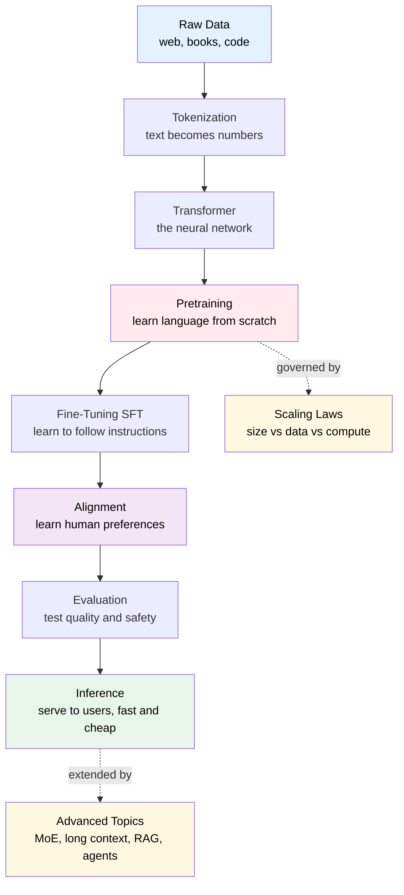

If you remember nothing else, remember this: **pretraining** teaches the model what the world sounds like. **Fine-tuning** teaches it what a helpful answer looks like. **Alignment** teaches it which answer humans actually prefer. Then we measure it, serve it efficiently, and extend it with newer tricks.

## Contents {#contents}

Click any chapter to jump straight to it.

<div class="llm-toc">
  <a class="llm-toc-card" href="#ch1">
    <span class="llm-toc-num">01</span>
    <span class="llm-toc-title">Data &amp; Tokenization</span>
    <span class="llm-toc-desc">Where training text comes from, how it gets cleaned, and how BPE turns strings into integers.</span>
  </a>
  <a class="llm-toc-card" href="#ch2">
    <span class="llm-toc-num">02</span>
    <span class="llm-toc-title">The Transformer</span>
    <span class="llm-toc-desc">Embeddings, self-attention with Q/K/V, multi-head attention, FFN, residuals, and a NumPy attention implementation.</span>
  </a>
  <a class="llm-toc-card" href="#ch3">
    <span class="llm-toc-num">03</span>
    <span class="llm-toc-title">Pretraining</span>
    <span class="llm-toc-desc">Next-token prediction, cross-entropy loss, the training loop, optimizers, schedules, and distributed training.</span>
  </a>
  <a class="llm-toc-card" href="#ch4">
    <span class="llm-toc-num">04</span>
    <span class="llm-toc-title">Fine-Tuning (SFT)</span>
    <span class="llm-toc-desc">Turning a base model into an assistant: chat templates, loss masking, and LoRA.</span>
  </a>
  <a class="llm-toc-card" href="#ch5">
    <span class="llm-toc-num">05</span>
    <span class="llm-toc-title">Alignment: RLHF &amp; DPO</span>
    <span class="llm-toc-desc">Preference data, reward models, PPO, and the much simpler DPO.</span>
  </a>
  <a class="llm-toc-card" href="#ch6">
    <span class="llm-toc-num">06</span>
    <span class="llm-toc-title">Evaluation</span>
    <span class="llm-toc-desc">Perplexity, benchmarks, pass@k, Arena Elo, LLM-as-judge, red-teaming, and the traps in all of them.</span>
  </a>
  <a class="llm-toc-card" href="#ch7">
    <span class="llm-toc-num">07</span>
    <span class="llm-toc-title">Inference &amp; Optimization</span>
    <span class="llm-toc-desc">Decoding, sampling knobs, the KV cache, batching, quantization, and speculative decoding.</span>
  </a>
  <a class="llm-toc-card" href="#ch8">
    <span class="llm-toc-num">08</span>
    <span class="llm-toc-title">Scaling Laws &amp; Compute</span>
    <span class="llm-toc-desc">Why bigger plus more data predictably wins, the Chinchilla rule, and the C = 6ND cost estimate.</span>
  </a>
  <a class="llm-toc-card" href="#ch9">
    <span class="llm-toc-num">09</span>
    <span class="llm-toc-title">Advanced Topics</span>
    <span class="llm-toc-desc">Mixture of Experts, long context, multimodality, RAG, agents, and reasoning models.</span>
  </a>
  <a class="llm-toc-card" href="#glossary">
    <span class="llm-toc-num">A&ndash;Z</span>
    <span class="llm-toc-title">Glossary</span>
    <span class="llm-toc-desc">Plain-English definitions of every key term, each linked back to the chapter that explains it.</span>
  </a>
</div>

### Three ways to read this {#paths}

<div class="llm-paths">
  <div class="llm-path">
    <h4>New to all of this</h4>
    <p>Go in order. <a href="#ch1">01</a> &rarr; <a href="#ch2">02</a> &rarr; <a href="#ch3">03</a>, then browse the rest as curiosity strikes.</p>
  </div>
  <div class="llm-path">
    <h4>You build apps on LLMs</h4>
    <p>You need the runtime, not the training rig. <a href="#ch2">02</a> &rarr; <a href="#ch7">07</a> &rarr; <a href="#ch9">09</a> for RAG and agents.</p>
  </div>
  <div class="llm-path">
    <h4>You want to train one</h4>
    <p>Follow the money and the gradients. <a href="#ch3">03</a> &rarr; <a href="#ch4">04</a> &rarr; <a href="#ch5">05</a> &rarr; <a href="#ch8">08</a>.</p>
  </div>
</div>

<div class="llm-note llm-idea">
<b>A note on the diagrams.</b> Every diagram on this page is live Mermaid, rendered in your browser. If one looks cramped on mobile, scroll it sideways.
</div>

<div class="llm-mark"><span>Chapter 01</span></div>

## Data and Tokenization {#ch1}

*How raw text from the open internet becomes the clean stream of integer tokens a language model actually trains on.*

A large language model never sees text the way you do. Before a single weight is trained, an enormous pile of raw text is **collected**, **cleaned**, **mixed**, and finally **tokenized**, which means chopped into small integer-labeled pieces called *tokens*. The model only ever sees those integers.

Two big ideas drive this whole stage:

1. **Garbage in, garbage out.** The model's ceiling is set by the data. Cleaning and mixing matter as much as the architecture.
2. **Integers, not text.** Neural networks do arithmetic on numbers. Tokenization is the bridge from human strings to model-ready integers.

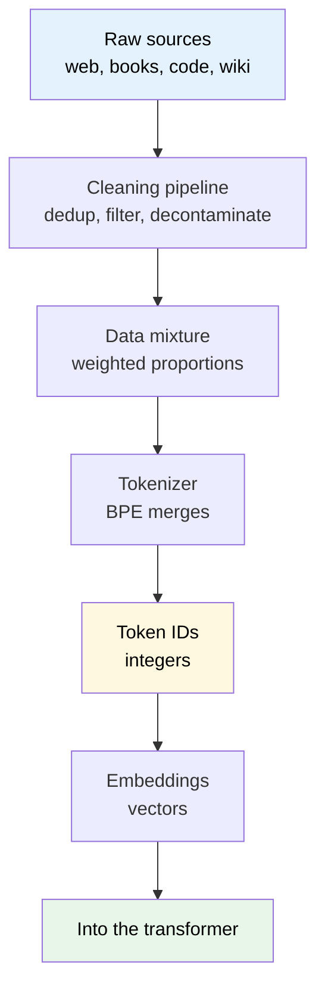

### 1.1 Data sources and scale

Frontier models are trained on *trillions* of tokens, enough text that no human could read a millionth of it in a lifetime. That text is scraped and assembled from a handful of broad buckets.

<div class="llm-note llm-analogy">
<b>Analogy.</b> Think of building a library for a very fast reader who will read <i>everything</i>, once. You want breadth (many topics), quality (few junk pamphlets), and the right balance (not 90% cooking blogs).
</div>

| Source | Why it is included | Rough character |
| --- | --- | --- |
| Web crawl (e.g. CommonCrawl) | Sheer scale and topical breadth | Huge, noisy, needs heavy filtering |
| Books | Long-form, coherent prose | High quality, smaller volume |
| Wikipedia | Factual, well-structured | Clean, encyclopedic, copied a lot |
| Code (public repos) | Reasoning, structure, tools | Boosts logic even for non-code tasks |
| Q&A and forums | Conversational, instructional | Mixed quality |
| Academic and reference | Depth and precision | Narrow but valuable |

**Scale intuition.** "Trillions of tokens" is the headline number. A rough rule of thumb: **1 token is about 0.75 English words, or about 4 characters.** So 1 trillion tokens is roughly 750 billion words, which is millions of books.

<div class="llm-note llm-example">
<b>Worked example.</b> Suppose you have 3 trillion tokens. Words = 3e12 x 0.75 = <b>2.25e12 words</b>. At ~100,000 words per book, that is about <b>22.5 million books</b> worth of text.
</div>

### 1.2 The data cleaning pipeline

Raw web text is full of duplicates, spam, boilerplate, broken HTML, adult content, personal data, and even copies of the very benchmarks you will test on later. A **cleaning pipeline** is a sequence of filters that each remove or fix a class of problems.

<div class="llm-note llm-analogy">
<b>Analogy.</b> Panning for gold. You wash away the mud (boilerplate), toss duplicate rocks (dedup), throw back the tiny ones (quality filter), and make sure you did not accidentally pan up the answer key for tomorrow's exam (decontamination).
</div>

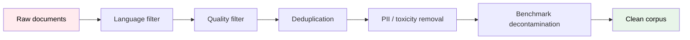

Each stage, in the order it typically runs:

- **Language filtering.** Keep documents in your target languages, using a classifier that scores "is this English?" This drops gibberish and unwanted languages early and cheaply.
- **Quality filtering.** Heuristics plus classifiers score whether text *looks like* good prose rather than spam or link farms. Useful signals: sentence length, symbol ratio, stopword presence, perplexity under a reference model.
- **Deduplication.** Remove exact and *near* duplicate documents so the model does not over-memorize repeated text. Usually done with hashing (MinHash or SimHash) to find near-dupes cheaply.
- **PII removal.** Scrub personally identifiable information (emails, phone numbers, SSNs) with regex plus classifiers.
- **Toxicity and safety filtering.** Down-weight or remove hateful, explicit, or harmful content.
- **Benchmark decontamination.** Remove any text overlapping with evaluation sets (see [chapter 06](#ch6)), so test scores reflect *generalization*, not memorization.

**Algorithm: near-duplicate detection (MinHash sketch)**

```text
1. For each document D:
2.    Split D into overlapping word n-grams (shingles).
3.    Hash every shingle; keep the k smallest hash values -> signature(D).
4. Two docs are "near duplicates" if their signatures overlap
   above a threshold t (this estimates Jaccard similarity).
5. Cluster near-duplicates; keep ONE representative per cluster.
```

**Code: a tiny dedup by content hash (the exact-dup version)**

```python
import hashlib

def dedup(docs):
    seen = set()          # holds hashes we've already kept
    kept = []
    for d in docs:
        # normalize lightly so trivial differences collapse
        norm = " ".join(d.lower().split())
        h = hashlib.md5(norm.encode()).hexdigest()
        if h not in seen:      # first time we've seen this content
            seen.add(h)
            kept.append(d)
    return kept

docs = ["Hello  world", "hello world", "Totally new doc"]
print(dedup(docs))   # -> ['Hello  world', 'Totally new doc']
```

<div class="llm-note llm-example">
<b>Worked example (quality filter).</b> A document has 1,000 characters, of which 400 are symbols or punctuation. Symbol ratio = 0.40. If the filter's threshold is "reject if symbol ratio &gt; 0.30," this doc is dropped. It is probably a menu, a code dump, or a spam wall, not prose.
</div>

### 1.3 Data mixtures and weighting

After cleaning, you do not just concatenate everything. You choose **proportions**, meaning how much of each source the model sees. A source can be *upsampled* (repeated) or *downsampled* regardless of its raw size.

<div class="llm-note llm-analogy">
<b>Analogy.</b> A diet. You have piles of many foods, but a healthy meal is not "whatever there is the most of." You deliberately set the ratio of protein to carbs to vegetables. Wikipedia is a multivitamin: small pile, but you want it well represented.
</div>

Why proportions matter:

- **Quality over raw volume.** There is far more web text than book text, but books are cleaner, so books often get *upweighted* relative to their size.
- **Capability shaping.** More code in the mix tends to improve reasoning even on non-code tasks.
- **Avoiding overfit to one style.** Too much of any single source biases tone and knowledge.

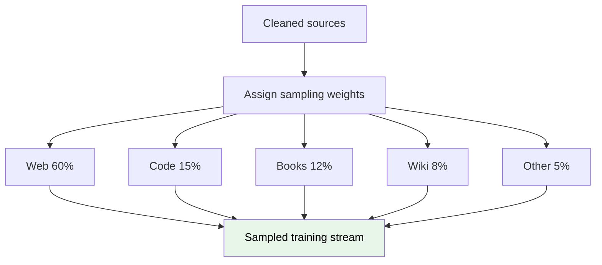

**Algorithm: weighted sampling of the training stream**

```text
1. Give each source i a weight w_i (the target proportion), sum(w_i) = 1.
2. To draw the next training document:
3.    Pick source i with probability w_i.
4.    Draw a document uniformly from source i (with replacement,
      so small high-value sources can be upsampled / repeated).
5. Repeat until the desired total token budget is reached.
```

**Code: sampling sources by weight**

```python
import numpy as np

sources = ["web", "code", "books", "wiki"]
weights = np.array([0.60, 0.15, 0.12, 0.08 + 0.05])  # last bucket folds "other" in
weights = weights / weights.sum()                    # normalize to sum 1

rng = np.random.default_rng(0)
draws = rng.choice(sources, size=10_000, p=weights)  # draw a stream
# empirical proportions should track the weights
for s in sources:
    print(s, round((draws == s).mean(), 3))
```

<div class="llm-note llm-example">
<b>Worked example (upsampling).</b> Wikipedia is only 2% of your cleaned tokens by raw size, but you want it to be 8% of what the model sees. You <i>upsample</i> it 4x, so each Wikipedia doc is drawn roughly 4 times on average, hitting the 8% target. Web text, being abundant, gets <i>downsampled</i> so it does not drown everything else.
</div>

### 1.4 Why tokenize at all?

The model needs a **finite vocabulary** of discrete symbols to map to integers. Two obvious choices both fail:

- **Whole words.** The vocabulary is effectively infinite (typos, names, new words, other languages). Any unseen word becomes an "unknown" hole.
- **Single characters.** The vocabulary is tiny, but sequences become extremely long, and each character carries little meaning, so the model wastes capacity.

**Subword tokenization** is the sweet spot. Common words become one token; rare words split into meaningful pieces. Nothing is ever truly "unknown" because in the worst case you fall back to bytes.

<div class="llm-note llm-analogy">
<b>Analogy.</b> Building with LEGO. You could carve every object from scratch (characters: slow and tedious) or buy one pre-built model per object (words: you will never have the exact piece you need). Instead you keep a box of reusable bricks (subwords). Frequent shapes are single bricks; rare shapes get assembled from smaller ones.
</div>

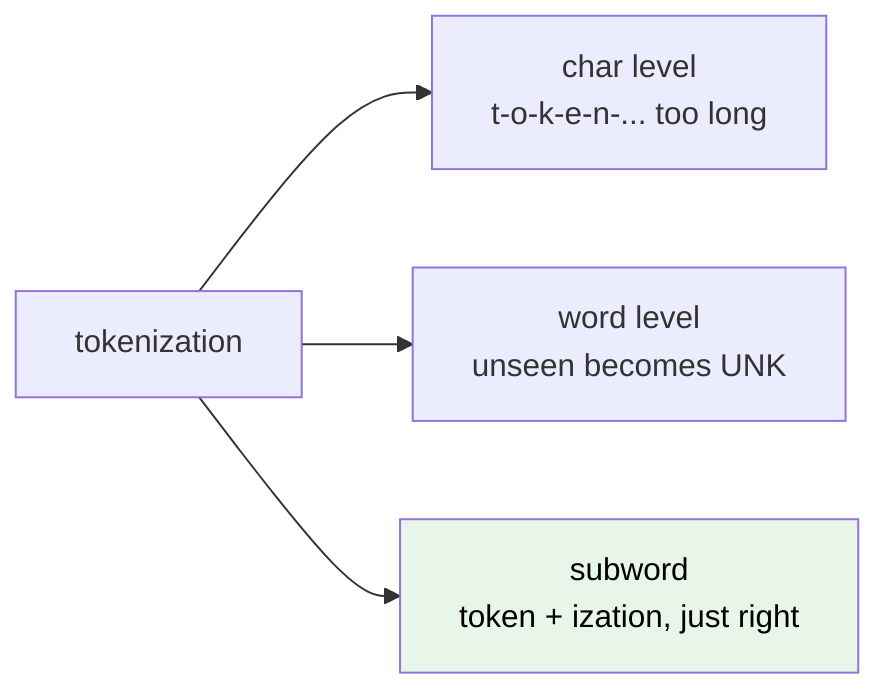

<div class="llm-note llm-example">
<b>Worked example.</b> The word <code>"tokenization"</code> might tokenize as <code>["token", "ization"]</code>, two reusable pieces. A common word like <code>" the"</code> is a <i>single</i> token. A weird string like <code>"asdfqwer"</code> falls back to several byte or character tokens. No unknowns, bounded vocabulary.
</div>

### 1.5 Byte-Pair Encoding (BPE)

BPE builds the subword vocabulary *from the data*. It starts with the smallest possible units (bytes or characters) and repeatedly **merges the most frequent adjacent pair** into a new token, until it reaches a target vocabulary size.

<div class="llm-note llm-analogy">
<b>Analogy.</b> Learning shorthand. You notice you write "t" then "h" then "e" constantly, so you invent one squiggle for "the." Then you notice "the" plus a space appears a lot, so you merge again. Each merge saves ink on the patterns that actually occur.
</div>

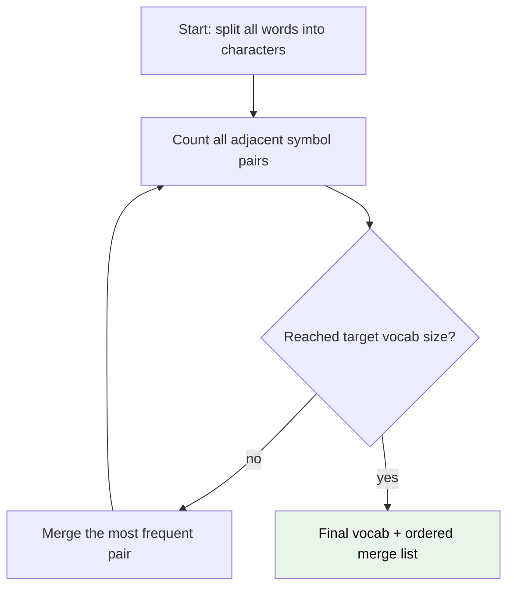

Key terms:

- **Vocab size.** The total number of tokens, roughly 50k to 130k for modern models. Bigger vocab means shorter sequences but a larger embedding table.
- **Merge list.** The *ordered* rules learned during training. Encoding new text replays these merges in order.
- **Special tokens.** Reserved IDs that are not learned from merges, such as `<|endoftext|>`, `<|pad|>`, `<|system|>`. They mark boundaries and roles.
- **Token IDs.** Every final token maps to a unique integer. That integer is all the model sees.

**Algorithm: BPE training (learning the merges)**

```text
1. Represent each word as a sequence of characters,
   with a word-boundary marker (e.g. trailing '</w>').
2. Count frequency of every adjacent symbol pair across the corpus.
3. Find the MOST FREQUENT pair (a, b).
4. Merge it: replace every "a b" with the new symbol "ab".
5. Record the merge rule (a, b) -> ab in an ordered list.
6. Repeat steps 2-5 until vocab reaches target size
   (or no pair repeats).
```

**Code: a minimal BPE trainer**

```python
from collections import Counter

def get_pairs(word_freqs):
    pairs = Counter()
    for word, freq in word_freqs.items():          # word is a tuple of symbols
        for a, b in zip(word, word[1:]):           # every adjacent pair
            pairs[(a, b)] += freq                  # weight by word frequency
    return pairs

def merge(word_freqs, pair):
    a, b = pair
    out = {}
    for word, freq in word_freqs.items():
        new, i = [], 0
        while i < len(word):                       # walk symbols, fuse a+b
            if i < len(word)-1 and word[i]==a and word[i+1]==b:
                new.append(a+b); i += 2
            else:
                new.append(word[i]); i += 1
        out[tuple(new)] = freq
    return out

# corpus as {word_as_symbol_tuple: count}
vocab = {("l","o","w","</w>"):5, ("l","o","w","e","r","</w>"):2,
         ("n","e","w","e","s","t","</w>"):6, ("w","i","d","e","s","t","</w>"):3}
merges = []
for _ in range(4):                                 # learn 4 merges
    best = get_pairs(vocab).most_common(1)[0][0]
    merges.append(best)
    vocab = merge(vocab, best)
print(merges)   # the ordered merge rules
```

#### Worked example: BPE merges step by step

Tiny corpus (word then count), each split into characters with a `</w>` end marker:

```
low </w>      x5
lower </w>    x2
newest </w>   x6
widest </w>   x3
```

Count adjacent pairs, weighted by word count. The pair `("e","s")` appears in `newest` (6) and `widest` (3), so **9**, and `("s","t")` also appears in both, so **9**. Tracing the top merges:

- **Merge 1:** `("e","s")` count = 9 (from `newest` + `widest`). Merge into `es`. Now `newest` is `n e w es t </w>` and `widest` is `w i d es t </w>`.
- **Merge 2:** `("es","t")` count = 9. Merge into `est`. Now `newest` is `n e w est </w>` and `widest` is `w i d est </w>`.
- **Merge 3:** `("est","</w>")` count = 9. Merge into `est</w>`. Both words now end in that single token.
- **Merge 4:** `("l","o")` count = 7 (`low` 5 plus `lower` 2). Merge into `lo`. Now `low` is `lo w </w>` and `lower` is `lo w e r </w>`.

**Ordered merge list learned:** `[(e,s), (es,t), (est,</w>), (l,o)]`.

Now **encode a new word**, `"lowest"`, by replaying merges *in order*:

```
start:      l o w e s t </w>
(e,s):      l o w es t </w>
(es,t):     l o w est </w>
(est,</w>): l o w est</w>
(l,o):      lo w est</w>
result:     ["lo", "w", "est</w>"]   -> 3 tokens
```

Notice that `"est</w>"`, learned from `newest` and `widest`, got *reused* for the unseen word `"lowest"`. That reuse is exactly why BPE generalizes.

### 1.6 Using a real tokenizer

In practice you do not hand-roll BPE. You load a pretrained tokenizer whose vocab and merges were learned once and frozen. A `tiktoken`-style API looks like this:

```python
import tiktoken

enc = tiktoken.get_encoding("cl100k_base")   # a real BPE vocab (~100k tokens)

text = "Tokenization is fun!"
ids = enc.encode(text)          # str -> list[int]
print(ids)                      # e.g. [3404, 2065, 374, 2523, 0]

print([enc.decode([i]) for i in ids])
# -> ['Token', 'ization', ' is', ' fun', '!']   (note the leading spaces!)

print(enc.decode(ids))          # ids -> str  (round-trips exactly)
# -> 'Tokenization is fun!'
```

Two things to notice:

- **Spaces belong to tokens.** `" is"` with a leading space is one token. The tokenizer encodes whitespace, not just letters.
- **Round-trip is lossless.** `decode(encode(x)) == x`, because in the worst case the tokenizer falls back to raw bytes.

<div class="llm-note llm-example">
<b>Worked example (text to tokens to IDs).</b>
<pre style="background:transparent;margin:8px 0 0;">text:    "Tokenization is fun!"
tokens:  ["Token", "ization", " is", " fun", "!"]
ids:     [ 3404,    2065,     374,   2523,   0   ]
count:   5 tokens</pre>
</div>

The model is now fed the sequence `[3404, 2065, 374, 2523, 0]`. Everything after this point is arithmetic on integers.

### 1.7 From token IDs to embeddings

An integer ID is not meaningful on its own. ID 3404 is not "twice" ID 1702. So each ID indexes into an **embedding table**, a big learned matrix with one row (a vector) per vocabulary entry. The model looks up the row for each ID and feeds those vectors forward.

<div class="llm-note llm-analogy">
<b>Analogy.</b> The token ID is a <i>seat number</i>; the embedding is the <i>person</i> sitting there. The number just tells you which learned vector to fetch.
</div>

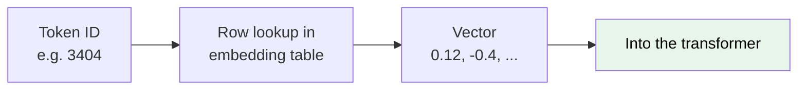

```python
import numpy as np

vocab_size, d_model = 100_000, 8          # d_model = embedding width
embedding = np.random.randn(vocab_size, d_model) * 0.02   # learned table

ids = [3404, 2065, 374, 2523, 0]          # our token IDs
vectors = embedding[ids]                  # fancy-index -> shape (5, 8)
print(vectors.shape)                      # (5, 8): one vector per token
```

With `d_model = 8`, our 5-token sequence becomes a `5 x 8` matrix: 5 rows of 8 numbers each. That matrix is the transformer's actual input. These embedding vectors are **learned during training**, and they are where "meaning" starts to live.

### Build it: train a real tokenizer

<div class="llm-note llm-run">
<b>Runnable.</b> This trains an actual BPE vocabulary on a real corpus and saves it to disk. We reuse this tokenizer in chapters 02 and 03, so run it first. <code>pip install tokenizers</code>
</div>

```python
import urllib.request
from tokenizers import Tokenizer, models, trainers, pre_tokenizers, decoders

# 1. Get a corpus (any plain-text file works; this one is ~1MB of Shakespeare)
urllib.request.urlretrieve(
    "https://raw.githubusercontent.com/karpathy/char-rnn/master/"
    "data/tinyshakespeare/input.txt", "corpus.txt")

# 2. Byte-level BPE: starts from raw bytes, so nothing is ever "unknown"
tok = Tokenizer(models.BPE())
tok.pre_tokenizer = pre_tokenizers.ByteLevel(add_prefix_space=False)
tok.decoder = decoders.ByteLevel()

# 3. Learn the merges (section 1.5) up to a target vocab size
trainer = trainers.BpeTrainer(
    vocab_size=8000,                                   # the dial from section 1.5
    special_tokens=["<|endoftext|>", "<|pad|>"],       # reserved IDs, not learned
    show_progress=True)
tok.train(["corpus.txt"], trainer)
tok.save("my-bpe.json")

# 4. Use it: text -> integers -> text
enc = tok.encode("Tokenization is fun!")
print(enc.tokens)                 # the subword pieces BPE actually chose
print(enc.ids)                    # the integers the model will see
print(tok.decode(enc.ids))        # round-trips losslessly
print("vocab size:", tok.get_vocab_size())
```

Open `my-bpe.json` and you will find the ordered merge list from section 1.5, written out as real data. That file *is* the tokenizer.

<div class="llm-takeaways" markdown="1">
#### Key takeaways
- **Scale and quality both matter.** Frontier models train on trillions of tokens, but the cleaning pipeline (dedup, quality and language filters, PII and toxicity, decontamination) sets the real ceiling.
- **Mixtures are deliberate.** Sources are weighted and up or down sampled, not just concatenated. Proportions shape the model's capabilities and style.
- **Tokenization bridges text to integers.** Subword tokenization beats both whole words (infinite vocab) and characters (sequences too long).
- **BPE learns its vocab from data** by repeatedly merging the most frequent adjacent pair, producing an ordered merge list that generalizes to unseen words.
- **The model only sees integers,** which become vectors via a learned embedding table. That table is the input to the transformer.
</div>

<div class="llm-nav">
  <a href="#contents">&uarr; Contents</a>
  <a href="#ch2">Next: The Transformer &rarr;</a>
</div>

<div class="llm-mark"><span>Chapter 02</span></div>

## The Transformer Architecture {#ch2}

*The decoder-only Transformer is a tall stack of identical blocks that turns a sequence of tokens into a probability distribution over the next token. That is the whole engine behind an LLM.*

A decoder-only Transformer (the GPT family, Llama, Mistral, and friends) does exactly one thing: **given the tokens so far, predict the next token.** Everything else, chat and code and summaries, is that single trick applied over and over.

The flow is top-down and refreshingly repetitive:

1. **Tokens in.** A prompt becomes a list of integer token IDs.
2. **Embed.** Each ID looks up a vector, and we add positional information so the model knows word order.
3. **Stack of blocks.** N identical Transformer blocks each refine the vectors. A block is *self-attention* (tokens look at each other) plus *feed-forward* (each token thinks on its own), wrapped in residuals and normalization.
4. **Project.** A final linear layer maps the last token's vector to one score (a logit) per vocabulary word.
5. **Softmax.** Logits become probabilities. We sample the next token, append it, and repeat.

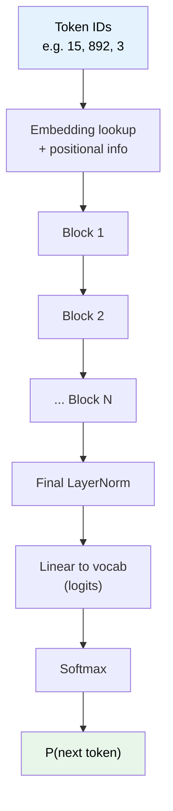

Every block has the same internal shape, so once you understand one block you understand the whole model. Let us build it from the bottom up.

### 2.1 Embeddings: token IDs become vectors

A token ID like `892` is just an index and carries no meaning by itself. The model keeps a big lookup table, the **embedding matrix**, with one row per vocabulary word. "Embedding" simply means *looking up the row for that ID* to get a vector of `d_model` numbers, say 768 of them. These vectors are learned during training, so similar words end up with similar vectors.

<div class="llm-note llm-analogy">
<b>Analogy.</b> Think of the embedding matrix as a dictionary where every word's "definition" is a list of coordinates in a high-dimensional space. Nearby coordinates mean related meanings.
</div>

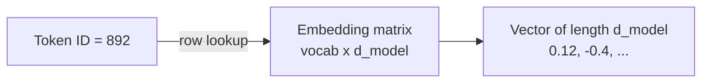

#### Positional information

Self-attention, covered next, is **permutation-invariant**. On its own it treats "dog bites man" and "man bites dog" identically. So we must inject order.

- **Sinusoidal positional encoding** (the original Transformer): add a fixed pattern of sines and cosines of different frequencies to each token's embedding. Position 0, 1, 2 and so on each get a unique, smooth signature.
- **RoPE (Rotary Positional Embeddings)**, used by Llama, Mistral, and most modern LLMs: instead of *adding* a vector, it *rotates* the Query and Key vectors by an angle proportional to position. This encodes *relative* distance directly inside attention and extrapolates better to long contexts.

```python
import numpy as np

def positional_encoding(seq_len, d_model):
    pos = np.arange(seq_len)[:, None]          # (seq_len, 1)
    i   = np.arange(d_model)[None, :]          # (1, d_model)
    angle = pos / (10000 ** (2 * (i // 2) / d_model))
    pe = np.zeros((seq_len, d_model))
    pe[:, 0::2] = np.sin(angle[:, 0::2])       # even dims -> sine
    pe[:, 1::2] = np.cos(angle[:, 1::2])       # odd dims  -> cosine
    return pe                                   # add this to embeddings
```

### 2.2 Self-attention: tokens look at each other

This is the heart of the Transformer. **Self-attention lets every token gather information from other tokens**, weighting them by relevance. When processing "it" in *"the cat sat because **it** was tired"*, attention lets "it" pull hard from "cat."

Each token produces three vectors, all via learned linear layers:

- **Query (Q):** "what am I looking for?"
- **Key (K):** "what do I offer?"
- **Value (V):** "what I will hand over if you pick me."

<div class="llm-note llm-analogy">
<b>Analogy.</b> It is a soft dictionary lookup. Your <b>Query</b> is the search box, every token's <b>Key</b> is a label on a folder, and the match between Query and Key decides how much of each folder's <b>Value</b> you take.
</div>

#### The formula: scaled dot-product attention

<div class="llm-formula">
Attention(<em>Q</em>, <em>K</em>, <em>V</em>) = softmax( <em>QK</em><sup>T</sup> / &radic;<em>d<sub>k</sub></em> + <em>M</em> ) <em>V</em>
<small>Q, K, V are the query, key and value matrices. d<sub>k</sub> is the key dimension. M is the causal mask.</small>
</div>

- `QKᵀ` scores how well each Query matches each Key, via a dot product.
- The `√dₖ` scaling keeps scores from exploding as dimension grows, which would make softmax razor-sharp and gradients vanish.
- `M` is the **causal mask**. It sets scores for *future* tokens to negative infinity so a token can never peek ahead. This is essential for next-token prediction.
- `softmax` turns each row of scores into weights summing to 1. Multiplying by `V` produces a weighted blend.

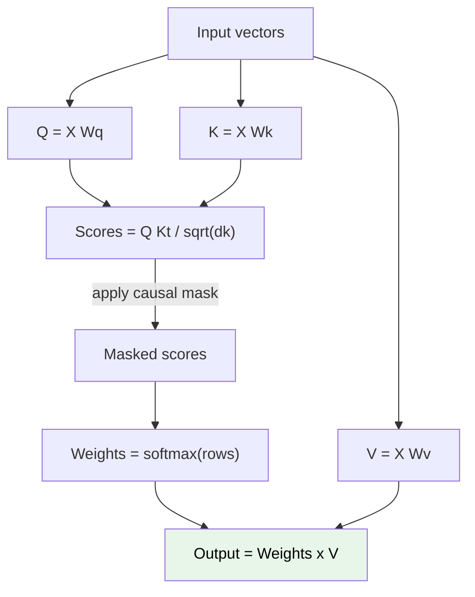

**Algorithm: scaled dot-product attention**

1. Compute the score matrix `S = Q @ K.T`, shape `seq x seq`.
2. Scale: `S = S / sqrt(d_k)`.
3. Apply the causal mask: for every position `i`, set `S[i, j] = -inf` where `j > i`.
4. Softmax each **row** of `S` to get weights `W`, so each row sums to 1.
5. Output `= W @ V`. Each token's new vector is a weighted sum of all Values it is allowed to see.

```python
import torch, torch.nn.functional as F

def scaled_dot_product_attention(Q, K, V, causal=True):
    d_k = Q.size(-1)
    scores = Q @ K.transpose(-2, -1) / d_k ** 0.5   # (seq, seq) match scores
    if causal:
        seq = scores.size(-1)
        # upper-triangular (future) positions -> -inf before softmax
        mask = torch.triu(torch.ones(seq, seq), diagonal=1).bool()
        scores = scores.masked_fill(mask, float("-inf"))
    weights = F.softmax(scores, dim=-1)             # rows sum to 1
    return weights @ V, weights                     # blended values, weights
```

#### Worked example with tiny numbers

Two tokens, `d_k = 2`. Suppose after the Q/K/V projections we have:

```
Q = [[1, 0],      K = [[1, 0],      V = [[10, 0],
     [0, 1]]           [0, 1]]           [ 0, 5]]
```

**Step 1, scores** `Q @ K.T`:

```
[[1, 0],
 [0, 1]]
```

**Step 2, scale** by `sqrt(2) = 1.414`:

```
[[0.707, 0.0  ],
 [0.0,   0.707]]
```

**Step 3, causal mask.** Token 0 cannot see token 1, so set the upper triangle to negative infinity:

```
[[0.707, -inf ],
 [0.0,    0.707]]
```

**Step 4, softmax each row:**

```
row 0 -> [1.0, 0.0]              # only itself is visible
row 1 -> [0.330, 0.670]          # softmax([0.0, 0.707])
```

**Step 5, output** `W @ V`:

```
token 0 -> 1.0*[10,0]                     = [10.0, 0.0]
token 1 -> 0.330*[10,0] + 0.670*[0,5]     = [3.30, 3.35]
```

Token 0 sees only itself. Token 1 blends both, leaning toward its own Value but pulling in some of token 0's. That blend is attention doing its job.

### 2.3 Multi-head attention: several perspectives at once

One attention operation can only emphasize one kind of relationship at a time. **Multi-head attention runs `h` attention operations in parallel**, each with its own smaller Q/K/V projections, then concatenates the results and mixes them with a final linear layer.

<div class="llm-note llm-analogy">
<b>Analogy.</b> A panel of specialists reading the same sentence. One head tracks grammar (subject to verb), another tracks long-range references ("it" to "cat"), another tracks topic. Each head attends in its own subspace, and the model fuses their findings.
</div>

If `d_model = 512` and `h = 8`, each head works in `d_k = 64` dimensions (512 / 8), so multi-head costs about the same as one full-width head but is far more expressive.

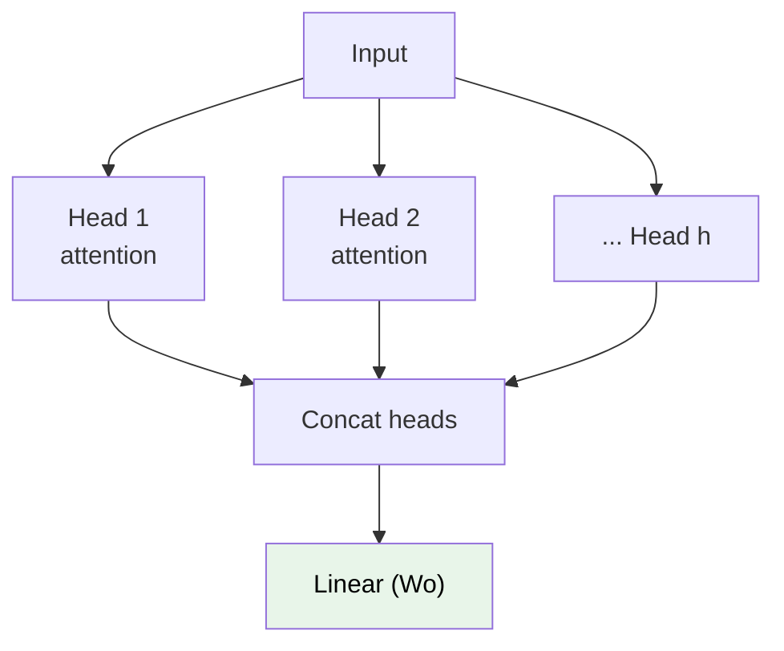

### 2.4 Feed-forward network: per-token thinking

After attention mixes information *between* tokens, the **position-wise feed-forward network (FFN)** processes each token *independently*. It is two linear layers with a nonlinearity in between, applied identically to every position:

<div class="llm-formula">
FFN(<em>x</em>) = <em>W</em><sub>2</sub> &middot; GELU( <em>W</em><sub>1</sub><em>x</em> + <em>b</em><sub>1</sub> ) + <em>b</em><sub>2</sub>
<small>Expand to a wider hidden layer, apply a smooth nonlinearity, contract back.</small>
</div>

The hidden layer is usually **4x wider** than `d_model`, for example 768 to 3072 to 768. This expand-then-contract shape gives the model room to compute richer nonlinear features. **GELU** (Gaussian Error Linear Unit) is the smooth activation of choice, like a softer ReLU that lets small negative values leak through.

<div class="llm-note llm-analogy">
<b>Analogy.</b> Attention is the group discussion. The FFN is each participant going away to think privately about what they just heard.
</div>

```python
import torch.nn as nn

class FFN(nn.Module):
    def __init__(self, d_model, hidden):        # hidden ~ 4 * d_model
        super().__init__()
        self.fc1 = nn.Linear(d_model, hidden)   # expand
        self.act = nn.GELU()                    # smooth nonlinearity
        self.fc2 = nn.Linear(hidden, d_model)   # contract back
    def forward(self, x):
        return self.fc2(self.act(self.fc1(x)))  # applied per token
```

### 2.5 Residuals and LayerNorm: keeping the stack trainable

Stacking dozens of layers naively makes training unstable, because gradients vanish or explode. Two tricks fix this.

- **Residual (skip) connection.** Add a sublayer's input to its output: `x + Sublayer(x)`. This gives gradients a clean highway straight down the stack and lets each block learn a small *adjustment* rather than a full transformation.
- **Layer normalization.** Rescale each token's vector to zero mean and unit variance, then learn a scale and shift. This keeps activations in a stable range.

Modern LLMs use **pre-norm**: normalize *before* each sublayer, `x + Sublayer(LayerNorm(x))`. Pre-norm keeps the residual highway completely clean and makes very deep models train reliably. Post-norm, the original design, is more finicky at depth.

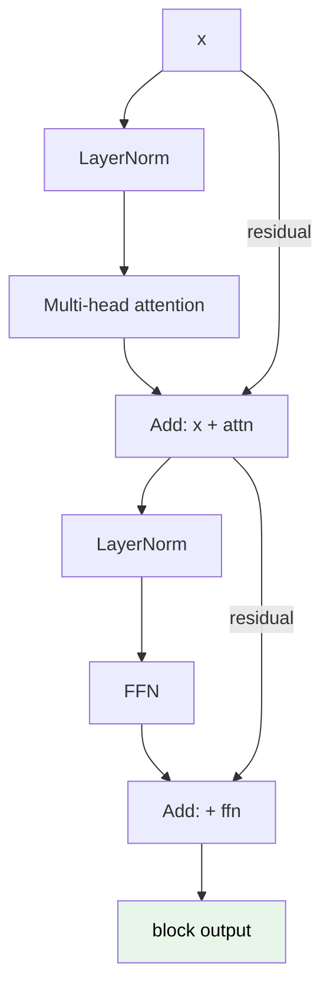

**Algorithm: one pre-norm block**

1. `a = MultiHeadAttention(LayerNorm(x))`
2. `x = x + a` (residual)
3. `f = FFN(LayerNorm(x))`
4. `x = x + f` (residual)
5. Return `x`. Same shape in, same shape out, so blocks stack freely.

### 2.6 Stacking blocks and producing probabilities

We stack **N** identical blocks. N is 12 for GPT-2 small, 32 for a 7B model, 80 or more for the largest. Because every block preserves the `seq x d_model` shape, they compose cleanly.

After the final block:

1. Apply a final LayerNorm.
2. A **linear projection** (the "LM head") maps each token's `d_model` vector to `vocab_size` scores called **logits**. This weight matrix is often *tied* to the embedding matrix to save parameters.
3. **Softmax** over the logits of the **last** position gives `P(next token)`.
4. **Sample** the next token (greedy, temperature, top-p: see [chapter 07](#ch7)), append it, and run again.

```python
# hidden: (seq, d_model) from the last block
hidden = final_layer_norm(hidden)
logits = hidden @ embedding.T          # (seq, vocab) -- weight tying
next_probs = torch.softmax(logits[-1], dim=-1)   # distribution for next token
```

### 2.7 Parameter-count intuition

Where do the billions of parameters live? Per block, two buckets dominate:

- **Attention:** four `d_model x d_model` matrices (Wq, Wk, Wv, Wo), so about `4 * d_model²`.
- **FFN:** two matrices of size `d_model x 4*d_model`, so about `8 * d_model²`.

So one block is roughly `12 * d_model²` parameters, with the FFN about 2x the attention. Plus the embedding table at `vocab * d_model`.

<div class="llm-note llm-example">
<b>Worked example: GPT-2 small.</b> <code>d_model = 768</code>, <code>N = 12</code>, <code>vocab = 50257</code>.
<pre style="background:transparent;margin:8px 0 0;">Per block  = 12 * 768^2      = 7.1M
All blocks = 12 * 7.1M       = 85M
Embeddings = 50257 * 768     = 39M   (shared with the LM head)
Total      = 124M                    (matches GPT-2 small's ~124M)</pre>
</div>

The handy rule of thumb: **transformer-block parameters are about `12 * N * d_model²`**, and embeddings matter most for small models with big vocabularies. Scaling `d_model` and `N` is exactly what [chapter 08](#ch8) is about.

### Build it: a complete GPT in 40 lines

<div class="llm-note llm-run">
<b>Runnable.</b> Every piece described above, assembled into a model you can instantiate and run a forward pass through right now. <code>pip install torch</code>
</div>

```python
import torch, torch.nn as nn

class Block(nn.Module):
    """One pre-norm transformer block: attention + FFN, both with residuals."""
    def __init__(self, d_model, n_heads):
        super().__init__()
        self.ln1  = nn.LayerNorm(d_model)
        self.attn = nn.MultiheadAttention(d_model, n_heads, batch_first=True)
        self.ln2  = nn.LayerNorm(d_model)
        self.ffn  = nn.Sequential(                      # section 2.4
            nn.Linear(d_model, 4 * d_model), nn.GELU(),
            nn.Linear(4 * d_model, d_model))

    def forward(self, x):
        T = x.size(1)
        # causal mask (section 2.2): True = "you may NOT look here"
        mask = torch.triu(torch.ones(T, T, dtype=torch.bool, device=x.device), 1)
        h = self.ln1(x)                                 # pre-norm
        a, _ = self.attn(h, h, h, attn_mask=mask, need_weights=False)
        x = x + a                                       # residual 1
        x = x + self.ffn(self.ln2(x))                   # residual 2
        return x

class MiniGPT(nn.Module):
    def __init__(self, vocab, d_model=256, n_heads=8, n_layers=6, block_size=256):
        super().__init__()
        self.tok_emb = nn.Embedding(vocab, d_model)     # section 2.1
        self.pos_emb = nn.Embedding(block_size, d_model)
        self.blocks  = nn.ModuleList(Block(d_model, n_heads) for _ in range(n_layers))
        self.ln_f    = nn.LayerNorm(d_model)
        self.head    = nn.Linear(d_model, vocab, bias=False)
        self.head.weight = self.tok_emb.weight          # weight tying (section 2.6)
        self.block_size = block_size

    def forward(self, idx):                             # idx: [B, T] token ids
        pos = torch.arange(idx.size(1), device=idx.device)
        x = self.tok_emb(idx) + self.pos_emb(pos)       # embed + position
        for b in self.blocks:
            x = b(x)
        return self.head(self.ln_f(x))                  # logits [B, T, vocab]

m = MiniGPT(vocab=8000)
print(f"{sum(p.numel() for p in m.parameters())/1e6:.1f}M params")
print(m(torch.randint(0, 8000, (2, 64))).shape)         # -> [2, 64, 8000]
```

Check the parameter count against the `12 · N · d_model²` rule from section 2.7. With `d_model=256` and `N=6` blocks you should get about 4.7M in the blocks, plus 2M in the embedding table.

<div class="llm-takeaways" markdown="1">
#### Key takeaways
- A decoder-only Transformer maps **tokens to a probability over the next token**, applied autoregressively.
- **Embeddings** turn IDs into vectors. **Positional encoding**, sinusoidal or (in modern models) RoPE, injects word order.
- **Self-attention** is `softmax(QKᵀ/√dₖ + mask) · V`. The **causal mask** stops tokens from seeing the future.
- **Multi-head** attention captures several relationship types at once. The **FFN** does per-token nonlinear processing.
- **Residual connections plus pre-norm LayerNorm** are what make deep stacks trainable.
- Parameters are about `12 * N * d_model²` for the blocks, plus `vocab * d_model` for embeddings.
</div>

<div class="llm-nav">
  <a href="#ch1">&larr; Previous: Data &amp; Tokenization</a>
  <a href="#contents">&uarr; Contents</a>
  <a href="#ch3">Next: Pretraining &rarr;</a>
</div>

<div class="llm-mark"><span>Chapter 03</span></div>

## Pretraining: Learning Language from Scratch {#ch3}

*Pretraining is where a randomly-initialized network becomes a language model, by doing one dumb thing billions of times: guessing the next token.*

The whole idea is almost embarrassingly simple. Take a huge pile of text. Chop it into tokens. Show the model a prefix and ask: *what token comes next?* Compare its guess to the real next token, nudge the weights to make the right answer more likely, and repeat trillions of times.

That is it. No labels, no humans annotating. The text labels itself, because the "answer" is just the next token already sitting in the data. This is why we call it **self-supervised** learning. Out of this one repetitive game, grammar, facts, reasoning patterns, and style all emerge as *side effects* of getting good at prediction.

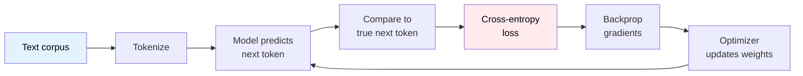

### 3.1 The objective: next-token prediction

**Causal language modeling** means the model predicts each token using *only* the tokens before it, never peeking ahead. "Causal" means it respects the arrow of time: token 5 may look at tokens 1 through 4, but not 6 and beyond. The transformer enforces this with the causal attention mask from [chapter 02](#ch2).

Given a sequence of tokens `x₁, x₂, ..., xₙ`, the model factorizes the probability of the whole sequence as a product of next-token probabilities:

<div class="llm-formula">
P(sequence) = P(<em>x</em><sub>1</sub>) &middot; P(<em>x</em><sub>2</sub> | <em>x</em><sub>1</sub>) &middot; P(<em>x</em><sub>3</sub> | <em>x</em><sub>1</sub>, <em>x</em><sub>2</sub>) &middot; ... &middot; P(<em>x</em><sub>n</sub> | <em>x</em><sub>1</sub> ... <em>x</em><sub>n-1</sub>)
</div>

<div class="llm-note llm-analogy">
<b>Analogy.</b> It is a fill-in-the-blank game where the blank is <i>always</i> at the end, and you slide it one word at a time through every text ever written. To predict "The capital of France is ___" well, the model has no choice but to absorb the fact. Prediction is the pressure; knowledge is what relieves it.
</div>

A neat efficiency win: within one sequence, we ask this question at *every* position simultaneously. A 1,000-token sequence yields 1,000 training signals in a single forward pass. Every prefix is a mini-example.

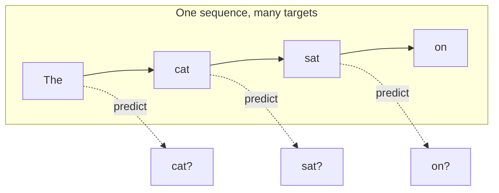

### 3.2 The loss: cross-entropy and perplexity

The model does not output one token. It outputs a **probability distribution** over the entire vocabulary, say 50,000 tokens. We need a number that says "how surprised were you by the *actual* next token?" That number is **cross-entropy loss**:

<div class="llm-formula">
loss for one token = &minus;log( <em>p</em><sub>model</sub>[true token] )
<small>Zero when the model was certain and right. Large when it assigned the truth low probability.</small>
</div>

If the model gave the true token probability 1.0, the loss is `-log(1) = 0`, perfect, no surprise. If it gave it 0.01, the loss is `-log(0.01) = 4.6`, very surprised, big penalty. We average this across all tokens in the batch. Minimizing cross-entropy means making the model assign high probability to what actually comes next.

**Perplexity** is just cross-entropy made human-readable: `perplexity = e^(loss)`. The intuition is that it is the effective number of equally-likely choices the model is torn between at each step. Perplexity 1 means perfectly certain and right. Perplexity 50,000 means totally clueless, a uniform guess over the whole vocab. Good language models get single-digit or low-double-digit perplexity on their eval sets.

#### Worked example: cross-entropy by hand

Tiny vocabulary of 4 tokens: `["cat", "dog", "sat", "ran"]`. The true next token is **"sat"** (index 2). The model outputs these probabilities:

| token | cat | dog | sat | ran |
|-------|-----|-----|-----|-----|
| p     | 0.1 | 0.2 | 0.6 | 0.1 |

Cross-entropy only looks at the probability of the *true* token, "sat" = 0.6:

> loss = -log(0.6) = **0.51 nats**

Now suppose a second position where the truth is "ran" but the model was confident it would be "cat":

| token | cat | dog | sat | ran |
|-------|-----|-----|-----|-----|
| p     | 0.7 | 0.1 | 0.1 | 0.1 |

> loss = -log(0.1) = **2.30 nats**

Average loss over these two tokens: `(0.51 + 2.30) / 2 = 1.41`. Perplexity: `e^1.41 = 4.1`. The model is behaving as if choosing among about 4 options, and with a vocab of 4 that is near-random. It has learning to do.

```python
import torch, torch.nn.functional as F

# logits: raw model scores (pre-softmax), shape [num_tokens, vocab]
logits = torch.tensor([[0.0, 0.7, 1.8, 0.0],    # position 1
                       [1.9, 0.0, 0.0, 0.0]])   # position 2
targets = torch.tensor([2, 3])                   # true tokens: "sat", "ran"

# cross_entropy applies softmax + (-log p[target]) + mean, in one call
loss = F.cross_entropy(logits, targets)
print(loss.item())                    # ~1.4
print(torch.exp(loss).item())         # perplexity ~4.1
```

### 3.3 The training loop

Everything comes together in a loop of four steps. Two of them, forward and loss, we have seen. The other two, **backward** and **step**, are how learning actually happens.

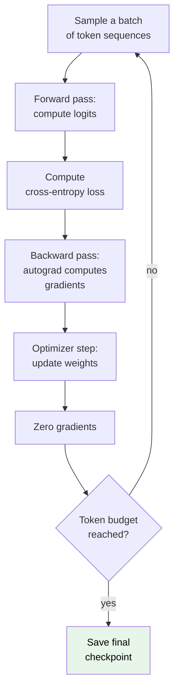

<div class="llm-note llm-idea">
<b>Gradient descent intuition.</b> Imagine the loss as a hilly landscape and the model's parameters as your coordinates on it. You want the lowest valley (lowest loss). At any point you can feel which way is downhill, and that direction is the <b>gradient</b> (technically its negative points downhill). You take a small step that way, feel again, step again. The step size is the <b>learning rate</b>. Too big and you overshoot the valley or bounce out. Too small and you crawl forever.
</div>

**Backpropagation, high level.** The gradient tells each of the model's billions of weights, "if you nudge yourself up a hair, does the loss go up or down, and how much?" Computing that for every weight sounds impossible, but the network is a chain of simple operations, and the chain rule from calculus lets you compute all these sensitivities in one backward sweep from the loss to the inputs. **Autograd** is the machinery in PyTorch that records every operation during the forward pass and replays it in reverse to produce the gradients. You never write derivatives by hand.

**Algorithm: the pretraining loop**

1. Initialize model parameters randomly, with small values.
2. Repeat until the token budget is spent:
   1. Sample a batch of token sequences from the corpus.
   2. **Forward:** run the batch through the model to get logits.
   3. **Loss:** compute average cross-entropy against the shifted targets (the next tokens).
   4. **Backward:** call autograd to compute the gradient of the loss for every parameter.
   5. **Clip:** rescale gradients if their global norm exceeds a threshold.
   6. **Step:** the optimizer updates the weights using the gradients and the current learning rate.
   7. **Zero:** clear the accumulated gradients before the next batch.
   8. Periodically save a checkpoint and log loss and perplexity.

```python
model = Transformer(...)                       # from chapter 02
opt = torch.optim.AdamW(model.parameters(), lr=3e-4, weight_decay=0.1)

for step, batch in enumerate(data_loader):     # batch: [B, T] token ids
    inputs  = batch[:, :-1]                     # all but last token
    targets = batch[:, 1:]                      # shifted by one = next tokens

    logits = model(inputs)                      # forward -> [B, T-1, vocab]
    loss = F.cross_entropy(
        logits.reshape(-1, logits.size(-1)),    # flatten positions
        targets.reshape(-1))                     # flatten targets

    loss.backward()                             # backward: fill .grad on each param
    torch.nn.utils.clip_grad_norm_(model.parameters(), 1.0)  # gradient clipping
    opt.step()                                  # update weights
    opt.zero_grad()                             # reset grads for next step
    # ... log loss, step LR schedule, checkpoint periodically
```

### 3.4 Optimizers: from SGD to AdamW

The **optimizer** decides how to turn gradients into weight updates. The simplest is **SGD** (Stochastic Gradient Descent): `θ ← θ - lr * gradient`. Just step downhill. It works, but it is twitchy. Noisy gradients make it zig-zag, and it treats every parameter with the same learning rate.

Two upgrades fix this:

- **Momentum.** Instead of stepping on the raw gradient, keep a running average of recent gradients, like a ball rolling downhill that builds speed. This smooths out noise and powers through flat spots.
- **Adaptive learning rates.** Scale each parameter's step by how big its gradients have *typically* been. Parameters with consistently large gradients get smaller, gentler steps. Rarely-updated parameters get larger ones.

**Adam** combines both. **AdamW** is Adam with **weight decay** decoupled, a gentle pull of every weight toward zero that discourages the model from relying on a few huge weights. AdamW is the de facto standard for pretraining LLMs.

**Gradient clipping**, the `clip_grad_norm_` call above, is a safety rail. If the total size of the gradient vector exceeds a threshold such as 1.0, scale it down to that threshold. This stops a single freak batch from producing a giant destabilizing update, a common cause of loss spikes and `NaN`s.

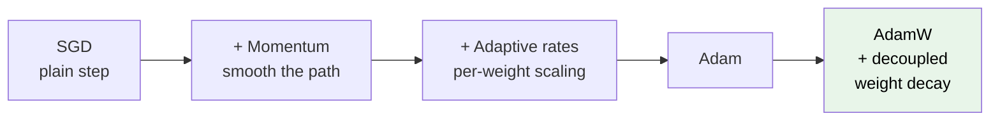

### 3.5 Learning-rate schedule: warmup then cosine decay

The learning rate is *not* constant during training. The standard recipe has two phases:

1. **Warmup.** For the first small fraction of steps, ramp the learning rate up *linearly* from near zero to its peak. Early on, the randomly-initialized model produces wild gradients, and a big learning rate immediately would blow it up. Warmup lets things settle.
2. **Cosine decay.** After the peak, smoothly lower the learning rate along a cosine curve toward zero by the end. Big steps early to make fast progress, tiny steps late to gently settle into a good minimum.

<div class="llm-note llm-analogy">
<b>Analogy.</b> Warm up your muscles before sprinting, then ease off as you approach the finish line so you do not overshoot it.
</div>

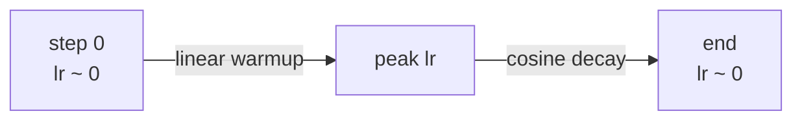

```python
import math

def lr_at(step, peak=3e-4, warmup=2000, total=100_000):
    if step < warmup:                            # phase 1: linear warmup
        return peak * step / warmup
    # phase 2: cosine decay from peak toward 0
    progress = (step - warmup) / (total - warmup)
    return 0.5 * peak * (1 + math.cos(math.pi * progress))

# apply before each opt.step():
for g in opt.param_groups:
    g["lr"] = lr_at(step)
```

### 3.6 Batching and the token budget

Two batch sizes matter, and conflating them causes confusion:

- **Micro-batch.** The chunk of sequences that fits in one GPU's memory in a single forward and backward pass. Limited by hardware.
- **Global (effective) batch.** The total number of sequences whose gradients you average together *before* taking one optimizer step. This is what actually affects training dynamics, and it is usually much larger than a micro-batch.

You bridge the gap with **gradient accumulation**: run several micro-batches, *add up* their gradients without stepping, then step once. Four micro-batches of 8 sequences gives an effective batch of 32, using the memory of only 8.

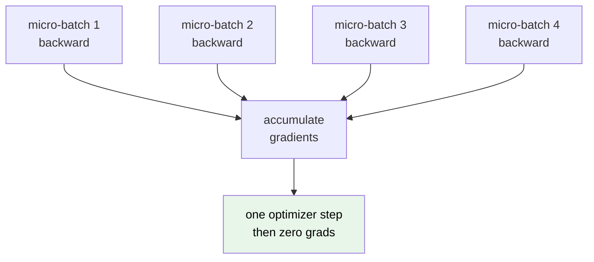

```python
accum = 4
for i, micro in enumerate(data_loader):
    loss = compute_loss(model, micro) / accum   # scale so the sum averages correctly
    loss.backward()                             # gradients ADD up across micro-batches
    if (i + 1) % accum == 0:                     # only step every `accum` micro-batches
        opt.step()
        opt.zero_grad()
```

<div class="llm-note llm-idea">
<b>Measure training in TOKENS, not epochs.</b> Because corpora are enormous and often seen roughly once, "how many epochs?" is the wrong question. The meaningful units are how many <b>tokens</b> the model has been trained on ("trained on 2 trillion tokens") and how many parameters it has. Per the <a href="#ch8">scaling laws</a>, those two numbers predict the outcome far better than epoch counts.
</div>

### 3.7 Mixed precision and checkpoints

**Mixed precision** trains using lower-precision numbers to save memory and go faster. The modern default is **bf16** (bfloat16, a 16-bit float). It has fewer significand bits than 32-bit `float32` but keeps the same exponent range, meaning it represents very large and very small values without overflowing, at the cost of some precision. It is roughly half the memory and much faster on modern accelerators, and it is stable enough that pretraining runs happily in bf16 while keeping a few sensitive accumulations in higher precision.

**Checkpoints** are periodic snapshots of everything needed to resume: model weights, optimizer state (Adam's momentum and variance buffers), the learning-rate schedule step, and the data position. A multi-week run *will* hit a hardware failure. Checkpointing every N steps means you restart from the last snapshot instead of from zero. Checkpoints are also what you hand off to [fine-tuning](#ch4).

### 3.8 Distributed training

No single GPU holds a large model *and* its optimizer state *and* a useful batch. Training is spread across many devices using a few complementary strategies, often combined into what people call "3D parallelism":

- **Data parallel.** Every GPU holds a full copy of the model and processes a different slice of the batch. After backward, they average gradients across all GPUs (an "all-reduce") so every copy stays in sync. This scales throughput, but needs the model to fit on one GPU.
- **Tensor parallel.** Split *individual layers*, for example a big matrix multiply, across GPUs, each computing part of the same operation. For when one layer is too big for one device.
- **Pipeline parallel.** Put *different layers* on different GPUs and stream micro-batches through like an assembly line, so device 1 works on batch B while device 2 works on batch B-1.
- **ZeRO / sharding.** Instead of every data-parallel replica redundantly storing the full optimizer state and gradients, *shard* them across GPUs so each holds only a slice. This dramatically cuts per-GPU memory, letting far larger models fit.

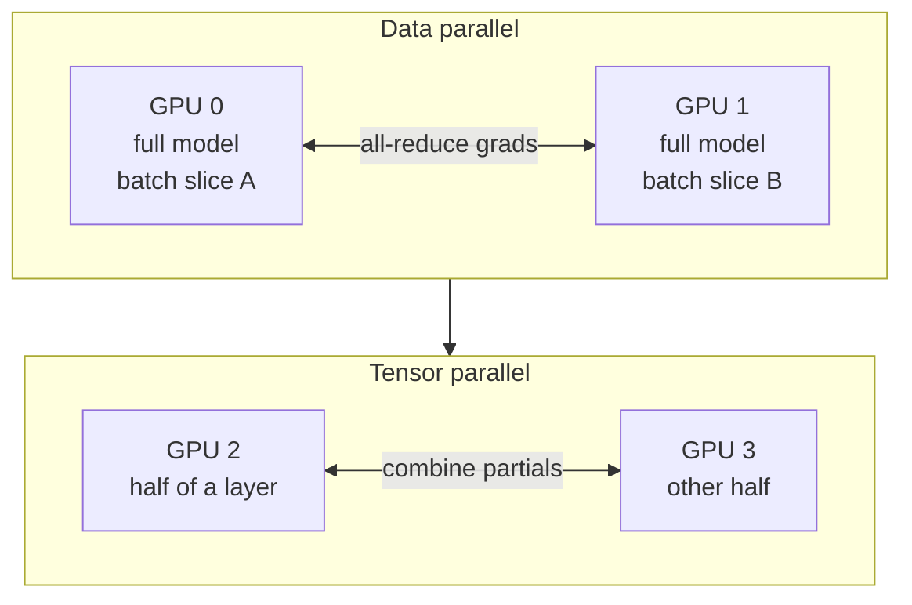

### 3.9 Compute and cost

Pretraining is the expensive part. Thousands of accelerators running for weeks, budgets in the millions. A useful rule of thumb: the training FLOPs needed is roughly `6 x parameters x tokens`. That single formula lets you estimate cost before spending a dollar, and it is the gateway to the **scaling laws**, the empirical rules that tell you how to spend a fixed compute budget. That trade-off gets its own chapter: [scaling laws and compute](#ch8).

### Build it: actually train the model

<div class="llm-note llm-run">
<b>Runnable.</b> This trains the <code>MiniGPT</code> from chapter 02 on the corpus you tokenized in chapter 01. It runs on a laptop CPU in a few minutes, faster on a GPU, and the loss visibly drops. Needs <code>my-bpe.json</code> and the <code>MiniGPT</code> and <code>lr_at</code> definitions from above.
</div>

```python
import math, torch, torch.nn.functional as F
from tokenizers import Tokenizer

tok  = Tokenizer.from_file("my-bpe.json")               # from chapter 01
text = open("corpus.txt").read()
data = torch.tensor(tok.encode(text).ids, dtype=torch.long)
n = int(0.9 * len(data))
train, val = data[:n], data[n:]                         # held-out split for eval
print(f"{len(data)/1e3:.0f}k tokens total")

dev   = "cuda" if torch.cuda.is_available() else "cpu"
model = MiniGPT(vocab=tok.get_vocab_size()).to(dev)
opt   = torch.optim.AdamW(model.parameters(), lr=3e-4, weight_decay=0.1)
B, T, STEPS = 16, 128, 2000                             # micro-batch, context, steps

def get_batch(split):
    d  = train if split == "train" else val
    ix = torch.randint(len(d) - T - 1, (B,))            # random windows
    x  = torch.stack([d[i     : i+T  ] for i in ix])
    y  = torch.stack([d[i + 1 : i+T+1] for i in ix])    # targets shifted by one
    return x.to(dev), y.to(dev)

for step in range(STEPS):
    for g in opt.param_groups:                          # warmup + cosine, section 3.5
        g["lr"] = lr_at(step, peak=3e-4, warmup=100, total=STEPS)

    x, y   = get_batch("train")
    logits = model(x)                                                # forward
    loss   = F.cross_entropy(logits.view(-1, logits.size(-1)),       # section 3.2
                             y.view(-1))
    loss.backward()                                                  # backward
    torch.nn.utils.clip_grad_norm_(model.parameters(), 1.0)          # clip
    opt.step(); opt.zero_grad()                                      # step, zero

    if step % 200 == 0:
        model.eval()
        with torch.no_grad():
            xv, yv = get_batch("val")
            vl = F.cross_entropy(model(xv).view(-1, tok.get_vocab_size()), yv.view(-1))
        model.train()
        print(f"step {step:4d}  train {loss.item():.3f}  "
              f"val {vl.item():.3f}  val ppl {math.exp(vl.item()):.1f}")

# Checkpoint everything needed to resume (section 3.7)
torch.save({"model": model.state_dict(), "opt": opt.state_dict(), "step": STEPS},
           "ckpt.pt")
```

Watch the validation perplexity fall from roughly the vocab size (8000, meaning total confusion) toward double digits. That drop *is* the model learning English, and it is the same curve, at a laughably smaller scale, that a frontier pretraining run produces.

<div class="llm-takeaways" markdown="1">
#### Key takeaways
- **Pretraining is next-token prediction at scale.** One self-supervised objective, and knowledge and skills emerge as side effects of getting good at it.
- **Cross-entropy** measures surprise at the true token (`-log p`). **Perplexity** (`e^loss`) is its human-readable "effective number of choices."
- The **loop** is forward, loss, backward (autograd), optimizer step, zero grads, repeated over trillions of tokens.
- **AdamW** (momentum plus adaptive rates plus weight decay) with **gradient clipping** is the standard, stable recipe.
- **Warmup then cosine decay:** ramp the learning rate up to avoid early blow-ups, then decay it to settle into a good minimum.
- Separate **micro-batch** (hardware limit) from **global batch** (training dynamics), and bridge them with **gradient accumulation**. Measure progress in **tokens, not epochs**.
- **bf16** mixed precision and frequent **checkpoints** make long runs feasible and recoverable.
- Large runs combine **data, tensor, and pipeline parallelism** with **ZeRO sharding** to fit model, optimizer, and batch across many GPUs.
</div>

<div class="llm-nav">
  <a href="#ch2">&larr; Previous: The Transformer</a>
  <a href="#contents">&uarr; Contents</a>
  <a href="#ch4">Next: Fine-Tuning &rarr;</a>
</div>

<div class="llm-mark"><span>Chapter 04</span></div>

## Supervised Fine-Tuning (SFT) {#ch4}

*How we take a raw next-token predictor and teach it to behave like a helpful assistant that follows instructions.*

A **base model**, also called a pretrained or foundation model, has read a huge slice of the internet and learned exactly one skill: predict the next token. That is astonishingly powerful, but it is not the same as being *helpful*. Ask a base model "What is the capital of France?" and it might reply "What is the capital of Germany? What is the capital of Spain?" Because on the internet, questions are often followed by *more questions*, not answers.

**Supervised Fine-Tuning (SFT)** fixes this. We continue training the same model, but now on a curated set of **(instruction, ideal response)** pairs. The model keeps all its knowledge and just learns a new *behavior*: when it sees an instruction, produce a helpful answer. "Supervised" simply means every training example comes with the correct target, so the ideal response is the label.

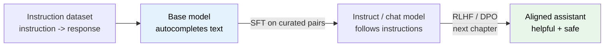

### 4.1 Base model vs instruct model

A base model is a **conditional probability machine**: given the tokens so far, it outputs a probability distribution over the next token. It has no built-in notion of "user" or "assistant". Those are roles *we* invent later.

<div class="llm-note llm-analogy">
<b>Analogy.</b> A base model is like a brilliant improv actor who will continue <i>any</i> scene you start, in whatever style the opening suggests. If your opening line reads like a forum post, you get a forum post back. SFT is the director sitting the actor down and saying: "From now on, when someone hands you a request, play the role of a helpful assistant who answers it."
</div>

```mermaid
flowchart TD
  P["Prompt:<br/>'What is the capital of France?'"] --> B{"Which model?"}
  B -->|"Base"| X["'What is the capital of Germany?'<br/>continues the pattern"]
  B -->|"Instruct"| Y["'The capital of France is Paris.'<br/>answers the request"]
  style X fill:#ffebee,color:#000
  style Y fill:#e8f5e9,color:#000
```

Same architecture, same tokenizer. The *only* difference is that the instruct model was additionally trained to treat instructions as things to be *satisfied* rather than *continued*.

### 4.2 Instruction datasets: quality over quantity

An SFT dataset is a list of examples, each roughly:

```json
{
  "instruction": "Explain what a hash map is to a beginner.",
  "response":    "A hash map stores key-value pairs so you can look up..."
}
```

The single most important lesson from the research community: **quality beats quantity**. A few thousand clean, diverse, correct examples often beat hundreds of thousands of noisy ones. The model already *knows* things from pretraining. SFT is mostly teaching **format and behavior**, not new facts. Bad examples actively teach bad habits: rambling, hallucinating, refusing reasonable requests.

Good SFT data is:

- **Correct.** The response is actually right and safe.
- **Diverse.** Many task types: summarize, code, reason, rewrite, refuse.
- **Consistent in style.** Similar tone and format, so the model learns one voice.
- **Representative.** It looks like what real users will actually ask.

<div class="llm-note llm-example">
<b>Worked example: one raw sample.</b> We will carry this exact sample through the next few sections.
<table style="margin-top:10px;">
<tr><th>Field</th><th>Value</th></tr>
<tr><td><code>system</code></td><td>"You are a concise, friendly assistant."</td></tr>
<tr><td><code>user</code></td><td>"Convert 5 miles to kilometers."</td></tr>
<tr><td><code>assistant</code></td><td>"5 miles is about 8.05 km (1 mile = 1.609 km)."</td></tr>
</table>
</div>

### 4.3 Chat templates and special tokens

To let one flat stream of tokens represent a *multi-turn conversation with roles*, we wrap each turn in **special tokens**, which are reserved tokens the tokenizer maps to single IDs (see [chapter 01](#ch1)). This wrapper is the **chat template**. Every model family has its own, but the important idea is universal: **delimiters mark where each role's turn begins and ends.**

<div class="llm-note llm-analogy">
<b>Analogy.</b> A chat template is like the formatting of a screenplay. <code>SYSTEM:</code>, <code>USER:</code>, <code>ASSISTANT:</code> are character-name headers that tell the actor whose line is whose. Without them, all the dialogue runs together and nobody knows who is speaking.
</div>

Here is our sample rendered in a common ChatML-style template. `<|im_start|>` and `<|im_end|>` are single special tokens that delimit turns:

```text
<|im_start|>system
You are a concise, friendly assistant.<|im_end|>
<|im_start|>user
Convert 5 miles to kilometers.<|im_end|>
<|im_start|>assistant
5 miles is about 8.05 km (1 mile = 1.609 km).<|im_end|>
```

At inference time we feed everything up to and including `<|im_start|>assistant\n`, and the model generates the rest until it emits `<|im_end|>`. That trailing `<|im_end|>` is also what teaches the model to **stop**. A base model never learned when to shut up.

```mermaid
flowchart LR
  S["system turn"] --> U["user turn"] --> A["assistant turn"]
  subgraph T["Each turn"]
    direction LR
    D1["start token +<br/>role name"] --> C["content"] --> D2["end token"]
  end
```

### 4.4 Loss masking, the key trick

Here is the crucial insight. During SFT we run the *whole* formatted conversation through the model, but we only want it to **learn to produce the assistant's tokens**. We do **not** want to reward it for predicting the user's question or the system prompt. Those are *given*, not something the assistant should generate.

The solution is **loss masking**: compute the next-token loss on assistant tokens only, and **mask out** every prompt token. In PyTorch, the convention is to set masked label positions to `-100`, which `CrossEntropyLoss` skips.

<div class="llm-note llm-analogy">
<b>Analogy.</b> Imagine grading a filled-in worksheet where the questions are pre-printed and the student wrote the answers. You only grade the answer blanks. You do not grade the student on the printed questions. Masking is drawing a box around exactly the answer blanks.
</div>

```mermaid
flowchart TD
  T["Full token sequence"] --> M{"Token belongs to<br/>assistant reply?"}
  M -->|"yes"| K["label = token id<br/>counts toward loss"]
  M -->|"no"| I["label = -100<br/>ignored / masked"]
  K --> L["Cross-entropy loss<br/>on kept tokens only"]
  I --> L
  style K fill:#e8f5e9,color:#000
  style I fill:#ffebee,color:#000
```

**Algorithm: building masked labels**

1. Render the conversation with the chat template into a token id list `input_ids`.
2. Create `labels` as a copy of `input_ids`.
3. Walk the sequence turn by turn, tracking which role each token belongs to.
4. For every token in a `system` or `user` turn, including its delimiters, set `labels[i] = -100`.
5. Keep `labels[i]` unchanged for tokens inside an `assistant` turn, including its closing end token, so the model learns to stop.
6. Shift so position `i` predicts token `i+1`. The model or loss usually does this internally.
7. Feed `input_ids` and `labels` to the loss. Masked positions contribute nothing.

```python
IGNORE = -100  # CrossEntropyLoss ignores this label

def build_labels(input_ids, assistant_spans):
    # assistant_spans: list of (start, end) index ranges that are
    # the assistant's tokens (inclusive of its <|im_end|>).
    labels = [IGNORE] * len(input_ids)          # mask everything first
    for start, end in assistant_spans:
        for i in range(start, end + 1):
            labels[i] = input_ids[i]            # unmask assistant tokens
    return labels

# Loss then ignores every -100 position automatically:
# loss = F.cross_entropy(logits.view(-1, V),
#                        labels.view(-1), ignore_index=IGNORE)
```

Only the assistant's tokens push gradients into the weights, so the model learns *what to say*, never *what it was asked*.

### 4.5 The SFT training loop

Mechanically, SFT is **the same loop as pretraining**: forward pass, cross-entropy loss, backprop, optimizer step. Just on curated pairs with masked labels.

**Algorithm: one SFT epoch**

1. Sample a batch of formatted conversations.
2. Tokenize and pad to a common length. Build `input_ids` and masked `labels`.
3. Forward pass to get `logits`.
4. Cross-entropy loss over **unmasked** positions only.
5. Backpropagate, clip gradients, step the optimizer and the learning-rate scheduler.
6. Repeat for a **small** number of epochs, often 1 to 3. More risks overfitting and memorizing.

```python
for batch in loader:
    logits = model(batch["input_ids"]).logits        # forward
    loss = F.cross_entropy(
        logits[:, :-1].reshape(-1, logits.size(-1)),  # predict next token
        batch["labels"][:, 1:].reshape(-1),           # shifted targets
        ignore_index=-100)                            # masked = ignored
    loss.backward()                                   # gradients
    optimizer.step(); optimizer.zero_grad()           # update weights
```

Key differences from pretraining: far **fewer steps**, a **smaller learning rate**, and **masked labels**. We are nudging behavior, not rebuilding knowledge.

### 4.6 Parameter-Efficient Fine-Tuning and LoRA

**Full fine-tuning** updates *every* weight in the model. For a 7-billion-parameter model that means storing gradients and optimizer state for all 7B weights, often **tens of gigabytes** of extra GPU memory beyond the model itself. Expensive, and you get a full copy of the model per task.

**PEFT** freezes the original weights and trains a tiny number of new parameters instead. The dominant PEFT method is **LoRA (Low-Rank Adaptation)**.

#### The LoRA idea

Take any weight matrix `W` of shape `(d, k)`. Instead of updating `W` directly, freeze it and learn a small **additive update** represented as the product of two skinny matrices:

<div class="llm-formula">
<em>W</em><sub>effective</sub> = <em>W</em> + &Delta;<em>W</em> = <em>W</em> + <em>B</em> &middot; <em>A</em>
<small>A is (r x k), B is (d x r), and the rank r is tiny (8 or 16) compared to d and k (often 4096).</small>
</div>

`B·A` still has shape `(d, k)`, the same as `W`, but it is built from only `r*(d + k)` numbers instead of `d*k`.

<div class="llm-note llm-analogy">
<b>Analogy.</b> The frozen <code>W</code> is a huge printed textbook you are not allowed to rewrite. LoRA is a thin pack of sticky notes (<code>A</code> and <code>B</code>) you add in the margins. Reading means textbook plus notes together. You only ever <i>write</i> the notes, and you can keep different note-packs for different tasks.
</div>

```mermaid
flowchart LR
  X["input x"] --> W["frozen W<br/>d x k"]
  X --> A["A (r x k)<br/>trainable"]
  A --> B["B (d x r)<br/>trainable"]
  W --> S["+ (add)"]
  B --> S
  S --> Y["output y"]
  style W fill:#eeeeee,color:#000
  style A fill:#e8f5e9,color:#000
  style B fill:#e8f5e9,color:#000
```

**Why it saves memory:** gradients and optimizer state are only needed for the *trainable* params. With LoRA that is `r*(d+k)` per matrix instead of `d*k`, often 100x to 1000x fewer trainable parameters. `B` is initialized to zero so `BA = 0` at the start, meaning training begins exactly at the base model's behavior and adapts from there.

```python
class LoRALinear(nn.Module):
    def __init__(self, base_linear, r=8, alpha=16):
        super().__init__()
        self.base = base_linear                 # frozen original W
        for p in self.base.parameters():
            p.requires_grad = False             # do NOT train W
        d, k = base_linear.out_features, base_linear.in_features
        self.A = nn.Parameter(torch.randn(r, k) * 0.01)  # (r x k)
        self.B = nn.Parameter(torch.zeros(d, r))         # (d x r), starts at 0
        self.scale = alpha / r                  # keeps update magnitude sane

    def forward(self, x):
        # y = xW^T  +  scale * x A^T B^T   (the low-rank update)
        return self.base(x) + self.scale * (x @ self.A.t()) @ self.B.t()
```

**QLoRA in one breath.** QLoRA is LoRA on top of a **quantized** base model (see [chapter 07](#ch7) for quantization). The frozen `W` is stored in 4-bit precision to slash memory, while the small `A` and `B` adapters stay in higher precision and are the only things trained. This is what lets people fine-tune large models on a single consumer GPU.

### 4.7 Catastrophic forgetting

Fine-tuning too hard on a narrow dataset can make a model **forget** general skills it had from pretraining. This is **catastrophic forgetting**. Train a chatbot only on Python questions and it may get worse at history or basic conversation.

<div class="llm-note llm-warn">
<b>Watch out.</b> Cramming only for one exam the night before can push older material out of your head. Same failure mode, same fix: spaced, mixed review.
</div>

Mitigations:

- **Mix the data.** Blend diverse tasks, and sometimes a little general text, so no single skill dominates.
- **Low learning rate and few epochs.** Smaller nudges preserve prior knowledge.
- **PEFT / LoRA.** Freezing the base weights *structurally* limits how much can be forgotten, since `W` itself never changes.

```mermaid
flowchart LR
  N["Narrow data only"] --> F["Strong new skill<br/>but general skills decay"]
  M["Mixed, diverse data"] --> G["New skill added<br/>general skills retained"]
  style F fill:#ffebee,color:#000
  style G fill:#e8f5e9,color:#000
```

### 4.8 Worked example, end to end

**(a) Raw sample to masked training sequence.** Take our earlier sample. After applying the chat template we get a token stream. Conceptually the labels look like this, where masked means `-100` and keep means the real token id used for loss:

```text
TOKENS (role)                                          LABEL
<|im_start|>system ... friendly assistant.<|im_end|>   masked (system)
<|im_start|>user Convert 5 miles to km.<|im_end|>      masked (user)
<|im_start|>assistant                                  masked (header)
5 miles is about 8.05 km (1 mile = 1.609 km).          keep ... keep  (LEARNED)
<|im_end|>                                             keep  (learn to stop)
```

Only the assistant's answer plus its closing token contribute to the loss. Everything the model was *given* is masked.

**(b) LoRA parameter savings.** Take one attention projection with `d = k = 4096`, using rank `r = 8`:

| Quantity | Full fine-tune | LoRA (r=8) |
| --- | --- | --- |
| Trainable params (this matrix) | `4096 x 4096` = **16,777,216** | `8 x (4096 + 4096)` = **65,536** |
| Ratio | 1.0x | **~0.39%**, about 256x fewer |

So this matrix trains **256x fewer** parameters. Across a whole 7B model, LoRA typically makes well under **1%** of parameters trainable, which is why the optimizer state (and the GPU bill) shrinks dramatically while the frozen base keeps all its knowledge intact.

### Build it: fine-tune a real model with LoRA

<div class="llm-note llm-run">
<b>Runnable.</b> Turns a real base model into an instruction follower using TRL and PEFT. The 0.5B model fits on a free Colab GPU. <code>pip install "transformers&gt;=4.45" datasets trl peft accelerate</code>
</div>

```python
from datasets import load_dataset
from transformers import AutoModelForCausalLM, AutoTokenizer
from peft import LoraConfig
from trl import SFTConfig, SFTTrainer

MODEL = "Qwen/Qwen2.5-0.5B"              # a BASE model: it only autocompletes
tok   = AutoTokenizer.from_pretrained(MODEL)
model = AutoModelForCausalLM.from_pretrained(MODEL, torch_dtype="bfloat16")

# Rows look like {"messages": [{"role": "user", ...}, {"role": "assistant", ...}]}
ds = load_dataset("HuggingFaceH4/ultrachat_200k", split="train_sft[:2000]")

lora = LoraConfig(                        # the sticky notes from section 4.6
    r=16, lora_alpha=32, lora_dropout=0.05, task_type="CAUSAL_LM",
    target_modules=["q_proj", "k_proj", "v_proj", "o_proj"])   # the attention Ws

trainer = SFTTrainer(
    model=model,
    train_dataset=ds,
    peft_config=lora,
    args=SFTConfig(
        output_dir="sft-out",
        num_train_epochs=1,               # 1 to 3 only (section 4.5)
        learning_rate=2e-4,               # LoRA tolerates a higher LR than full FT
        per_device_train_batch_size=2,
        gradient_accumulation_steps=8,    # effective batch 16 (section 3.6)
        bf16=True,
        max_length=1024,
        assistant_only_loss=True,         # <-- loss masking, section 4.4
    ))

trainer.train()
trainer.save_model("sft-out")             # saves ONLY the adapter, a few MB
```

Two lines earn their keep. `assistant_only_loss=True` is the loss masking from section 4.4, applied for you: TRL walks the chat template and sets every prompt token's label to `-100`. And `peft_config=lora` means the saved output is a few megabytes of `A` and `B` matrices instead of a full model copy.

Compare before and after on the same prompt:

```python
from transformers import pipeline
from peft import PeftModel

base = AutoModelForCausalLM.from_pretrained(MODEL, torch_dtype="bfloat16")
tuned = PeftModel.from_pretrained(base, "sft-out")     # base + sticky notes

msgs = [{"role": "user", "content": "What is the capital of France?"}]
ids = tok.apply_chat_template(msgs, add_generation_prompt=True, return_tensors="pt")
print(tok.decode(tuned.generate(ids, max_new_tokens=40)[0][ids.shape[-1]:],
                 skip_special_tokens=True))
```

<div class="llm-takeaways" markdown="1">
#### Key takeaways
- A **base model** only autocompletes. **SFT** teaches it to *follow instructions* using (instruction, response) pairs. Same weights, new behavior.
- **Quality beats quantity.** A few thousand clean, diverse examples outperform mountains of noisy ones, because SFT teaches format and behavior, not facts.
- **Chat templates** use **special tokens** to mark system, user, and assistant turns, and to teach the model when to **stop**.
- **Loss masking** (`-100`) is the essential trick: train on **assistant tokens only**, ignore the prompt.
- The **training loop is the same as pretraining**, just fewer steps, lower learning rate, and masked labels.
- **LoRA** freezes `W` and learns a low-rank update `B·A`, cutting trainable params 100x to 1000x. **QLoRA** adds 4-bit quantization for single-GPU fine-tuning.
- **Mix diverse data** and keep training gentle to avoid **catastrophic forgetting**.
</div>

<div class="llm-nav">
  <a href="#ch3">&larr; Previous: Pretraining</a>
  <a href="#contents">&uarr; Contents</a>
  <a href="#ch5">Next: Alignment &rarr;</a>
</div>

<div class="llm-mark"><span>Chapter 05</span></div>

## Alignment: RLHF and DPO {#ch5}

*How we teach a model not just to speak fluently, but to say the things humans actually prefer: helpful, honest, and harmless answers.*

After SFT, a model can follow instructions and produce well-formatted answers. But "well-formatted" is not the same as "good." For any prompt there are thousands of grammatically correct, on-format replies. Some are warm and useful, some are curt, some are subtly wrong, some are unsafe. SFT can only imitate the reference answers it was shown. It has no notion that answer A is *preferred* to answer B.

**Alignment** closes that gap by optimizing a *preference signal* instead of a fixed target. The usual goals are summarized as the three H's:

- **Helpful.** Actually answers the question and follows intent.
- **Honest.** Says true things, admits uncertainty, does not fabricate.
- **Harmless.** Declines dangerous or abusive requests gracefully.

There are two dominant families of methods. **RLHF** (Reinforcement Learning from Human Feedback) trains a separate *reward model* and then uses reinforcement learning (PPO) to push the policy toward high reward. **DPO** (Direct Preference Optimization) skips the reward model and the RL loop entirely, and optimizes the preferences directly with a simple classification-style loss.

```mermaid
flowchart TD
    A["SFT model<br/>follows format"] --> B["Collect preference data<br/>chosen vs rejected"]
    B --> C{"Which method?"}
    C -->|"RLHF"| D["Train reward model<br/>scores responses"]
    D --> E["PPO loop<br/>maximize reward - KL"]
    C -->|"DPO"| F["Optimize preferences directly<br/>no reward model, no RL"]
    E --> G["Aligned model<br/>helpful, honest, harmless"]
    F --> G
    style A fill:#e3f2fd,color:#000
    style G fill:#e8f5e9,color:#000
```

### 5.1 Preference data: humans rank pairs

Instead of asking annotators to *write* the perfect answer, which is hard, expensive, and subjective, we ask an easier question: **"Given these two answers to the same prompt, which is better?"** Judging is far easier and more consistent than authoring.

The data unit is a triple: a prompt `x`, a **chosen** response `y_w` (the winner), and a **rejected** response `y_l` (the loser). Both responses are typically sampled from the current model, so the comparison is between things the model actually produces.

```mermaid
flowchart LR
    P["Prompt x"] --> M["SFT model"]
    M --> R1["Response A"]
    M --> R2["Response B"]
    R1 --> H["Human labeler"]
    R2 --> H
    H -->|"A preferred"| D["chosen = A<br/>rejected = B"]
    style D fill:#e8f5e9,color:#000
```

<div class="llm-note llm-analogy">
<b>Analogy.</b> It is like blind taste-testing two coffees rather than asking someone to describe their ideal cup. People are bad at specifying and good at comparing.
</div>

A dataset is just many such triples. Note what we *do not* have: a numeric score for each answer. We only have ordinal comparisons. The next piece turns those comparisons into numbers.

### 5.2 The reward model and Bradley-Terry loss

A **reward model (RM)** is a neural network `r(x, y)` that reads a prompt and a response and outputs a single scalar, a "goodness" score. It is usually the SFT model with its final token-prediction head swapped for a one-number regression head.

The problem: our labels are comparisons, not scores. How do you learn a scoring function from "A beats B" judgments? The **Bradley-Terry model** gives the bridge. It assumes the probability that the chosen answer beats the rejected one is the **sigmoid of the difference** in their rewards:

<div class="llm-formula">
P(<em>y<sub>w</sub></em> &#8827; <em>y<sub>l</sub></em>) = &sigma;( <em>r</em>(<em>x</em>, <em>y<sub>w</sub></em>) &minus; <em>r</em>(<em>x</em>, <em>y<sub>l</sub></em>) )
<small>where &sigma;(z) = 1 / (1 + e<sup>&minus;z</sup>)</small>
</div>

Bigger reward gap means higher probability the winner wins. We train the RM to make this probability large for every labeled pair, which means minimizing the negative log-likelihood:

<div class="llm-formula">
<em>L</em><sub>RM</sub> = &minus; E [ log &sigma;( <em>r</em>(<em>x</em>, <em>y<sub>w</sub></em>) &minus; <em>r</em>(<em>x</em>, <em>y<sub>l</sub></em>) ) ]
</div>

This is just binary classification: "was the chosen answer really preferred?" Only the *difference* in rewards matters, so the absolute scale is arbitrary. That is a nice property, because we never needed real numeric labels.

**Algorithm: training the reward model**

1. Initialize the reward model from the SFT model, replacing the LM head with a scalar head.
2. Sample a batch of preference triples.
3. Compute reward for the chosen: `s_w = r(x, y_w)`.
4. Compute reward for the rejected: `s_l = r(x, y_l)`.
5. Compute loss `-log σ(s_w - s_l)` and average over the batch.
6. Backpropagate and update the weights.
7. Repeat 2 through 6 until validation pairwise accuracy plateaus.

```python
import torch
import torch.nn.functional as F

def reward_model_loss(reward_model, prompt, chosen, rejected):
    # r(x, y): one scalar score per (prompt, response)
    s_w = reward_model(prompt, chosen)     # reward for the chosen answer
    s_l = reward_model(prompt, rejected)   # reward for the rejected answer

    # Bradley-Terry: P(chosen wins) = sigmoid(s_w - s_l)
    # -log sigmoid(z) == softplus(-z), a numerically stable form.
    loss = F.softplus(-(s_w - s_l))        # = -log sigmoid(s_w - s_l)
    return loss.mean()                     # average over the batch

# Intuition: minimizing this pushes s_w above s_l for every labeled pair.
```

<div class="llm-note llm-example">
<b>Worked example.</b> Suppose the trained reward model scores two answers to the same prompt: chosen <code>s_w = 2.0</code>, rejected <code>s_l = 0.5</code>. The difference is <code>z = 1.5</code>. Plug into the sigmoid:
<pre style="background:transparent;margin:8px 0;">P(chosen wins) = sigma(1.5) = 1 / (1 + e^(-1.5))
               = 1 / (1 + 0.2231) = 0.818</pre>
So the model believes the chosen answer is preferred about <b>82%</b> of the time. Confident, but not certain. If the scores were equal (<code>z = 0</code>), the probability would be <code>sigma(0) = 0.5</code>, a coin flip, exactly what "no preference" should mean. If the gap were <code>z = 3.0</code>, the probability climbs to about <b>0.953</b>.
</div>

### 5.3 RLHF with PPO

Now we have a reward model that scores any response. RLHF uses reinforcement learning to update the **policy**, the language model we are improving, so it generates responses the reward model rates highly.

Two copies of the model are involved:

- **Policy.** The model being trained. It generates responses and gets updated.
- **Reference.** A frozen copy of the SFT model. It never changes.

Why keep a frozen reference? Because the reward model is an imperfect proxy. If you optimize it too hard, the policy discovers weird text that scores high but is nonsense. This is **reward hacking**. To prevent it, RLHF adds a **KL penalty** (Kullback-Leibler divergence, a measure of how far two probability distributions are apart) that punishes the policy for drifting away from the reference. The effective per-response reward becomes:

<div class="llm-formula">
<em>R</em> = <em>r</em>(<em>x</em>, <em>y</em>) &minus; &beta; &middot; KL( &pi;<sub>&theta;</sub>(<em>y</em>|<em>x</em>) || &pi;<sub>ref</sub>(<em>y</em>|<em>x</em>) )
<small>&beta; trades off "chase reward" against "stay close to the sensible SFT model."</small>
</div>

```mermaid
flowchart TD
    P["Prompt x"] --> POL["Policy<br/>being trained"]
    POL --> Y["Sampled response y"]
    Y --> RM["Reward model<br/>r(x, y)"]
    Y --> REF["Reference<br/>frozen"]
    RM -->|"reward"| C["Combine:<br/>reward - beta * KL"]
    REF -->|"KL penalty"| C
    C -->|"PPO update"| POL
    style REF fill:#eeeeee,color:#000
```

The optimizer is **PPO** (Proximal Policy Optimization). You do not need its full derivation, but three pieces are worth naming:

- **Advantage.** How much better a response was than the model's baseline expectation. Positive advantage means make this behavior more likely.
- **Clipped objective.** PPO limits how far the policy can move in a single update by *clipping* the probability ratio between the new and old policy. This is a safety rail against destabilizing jumps.
- **KL term.** The drift penalty above, keeping the policy anchored to the reference.

**Algorithm: the PPO alignment loop**

1. Initialize the policy and a frozen reference, both from the SFT model.
2. Sample a batch of prompts, and generate responses from the current policy.
3. Score each response with the reward model.
4. Compute the KL penalty between policy and reference for those responses.
5. Form the shaped reward `R = r - β·KL` and estimate advantages.
6. Take several PPO gradient steps on the clipped objective.
7. Repeat 2 through 6 for many iterations, monitoring reward *and* KL together.

<div class="llm-note llm-warn">
<b>The catch.</b> This loop is heavy. You run generation, a reward model, a reference model, and a policy, so up to four models in memory. And RL is famously finicky to tune. That pain is exactly what motivated the next method.
</div>

### 5.4 DPO: Direct Preference Optimization

**DPO's key insight:** you can achieve the same objective as RLHF *without* training a separate reward model and *without* the RL loop. A bit of math shows the optimal RLHF policy has a closed-form relationship to the reward, which lets you rewrite the reward *in terms of the policy itself*. Substitute that back into the Bradley-Terry loss and you get a loss you can optimize directly on preference pairs, with plain supervised-style gradient descent.

<div class="llm-note llm-analogy">
<b>Analogy.</b> RLHF is like hiring a judge (the reward model), then coaching an athlete against that judge's scores in a slow feedback loop. DPO cuts out the judge and coaches the athlete directly from the recorded "A beat B" verdicts.
</div>

The DPO loss uses the **log-probability ratio** between the policy and the frozen reference for each response. Define the implicit reward for a response as `β · log( π(y|x) / π_ref(y|x) )`. Then:

<div class="llm-formula">
<em>L</em><sub>DPO</sub> = &minus; E [ log &sigma;( &beta; &middot; ( log(&pi;<sub>&theta;</sub>(<em>y<sub>w</sub></em>)/&pi;<sub>ref</sub>(<em>y<sub>w</sub></em>)) &minus; log(&pi;<sub>&theta;</sub>(<em>y<sub>l</sub></em>)/&pi;<sub>ref</sub>(<em>y<sub>l</sub></em>)) ) ) ]
<small>The same sigmoid-of-a-difference shape as the reward-model loss, but the "reward" is now the policy's own log-ratio against the reference.</small>
</div>

Minimizing it raises the policy's probability on chosen answers and lowers it on rejected ones, while the reference term (and `β`) keeps it from drifting, giving KL regularization for free.

```mermaid
flowchart LR
    subgraph S["DPO forward pass"]
      W["chosen y_w"] --> LR1["log-ratio<br/>policy vs ref"]
      L["rejected y_l"] --> LR2["log-ratio<br/>policy vs ref"]
    end
    LR1 --> D["margin = LR1 - LR2"]
    LR2 --> D
    D -->|"-log sigmoid(beta * margin)"| U["Update policy"]
    style U fill:#e8f5e9,color:#000
```

```python
import torch.nn.functional as F

def dpo_loss(policy_lp, ref_lp, beta=0.1):
    # Each arg is a dict of summed log-probs of a response under a model:
    #   policy_lp["chosen"], policy_lp["rejected"], ref_lp["chosen"], ...
    # log-ratio = how much MORE likely the policy makes this response vs the ref
    chosen_logratio   = policy_lp["chosen"]   - ref_lp["chosen"]
    rejected_logratio = policy_lp["rejected"] - ref_lp["rejected"]

    # margin > 0 means the policy favors the chosen answer more than the ref does
    margin = beta * (chosen_logratio - rejected_logratio)

    # Same Bradley-Terry shape: -log sigmoid(margin)
    return -F.logsigmoid(margin).mean()

# Only the policy is trained; ref_lp comes from the frozen reference (no grad).
```

**Why DPO is simpler and more stable:** no reward model to train and maintain, no online sampling during training (the pairs are fixed), and only two models in play (policy plus frozen reference) instead of four. It is a single supervised objective, so it trains like ordinary fine-tuning, with far fewer knobs than PPO and much less prone to reward hacking.

The trade-off: it learns from a *fixed* dataset, whereas PPO can explore fresh responses on-policy, which sometimes reaches higher ceilings on hard tasks.

### 5.5 AI feedback: RLAIF, Constitutional AI, and RLVR

Human labeling is slow and costly. Two ideas reduce the human bottleneck.

**RLAIF (RL from AI Feedback)** replaces the human preference labeler with a capable LLM. You show the judge model two responses and ask which is better, and its verdicts become the preference dataset. The rest of the pipeline, reward model or DPO, is unchanged. This scales cheaply and, surprisingly, often matches human-labeled quality.

**Constitutional AI (CAI)** structures that AI feedback around an explicit written **constitution**, a short list of principles like "choose the response that is most helpful and least harmful." The model critiques and revises its own answers against these principles, then those AI judgments train the aligned model. The values become auditable text instead of being buried implicitly in thousands of human clicks.

```mermaid
flowchart TD
    C["Constitution<br/>written principles"] --> J["LLM judge<br/>critiques + ranks"]
    A["Two responses"] --> J
    J -->|"AI preference"| P["Preference dataset"]
    P --> T["Reward model or DPO"]
    T --> M["Aligned model"]
    style C fill:#fff8e1,color:#000
    style M fill:#e8f5e9,color:#000
```

**RLVR (RL from Verifiable Rewards)** takes a different route for domains where correctness can be *checked automatically*: math (does the final answer match?), code (do the unit tests pass?), formal proofs (does the checker accept it?). There is no preference model and no subjective judgment. The reward is a hard, programmatic signal, often just `1` for correct and `0` otherwise. Because the signal is objective and cheap, you can run huge amounts of RL against it. This is the engine behind recent **reasoning models** that improve at math and coding by generating long chains of thought and getting rewarded only when the final result verifies.

<div class="llm-note llm-analogy">
<b>Analogy.</b> RLHF and RLAIF are grading an essay, which needs a judge's taste. RLVR is grading a math test, where there is an answer key.
</div>

### Build it: align a model with DPO

<div class="llm-note llm-run">
<b>Runnable.</b> The full DPO loss from section 5.4, applied to a real preference dataset. Note there is no reward model and no RL loop anywhere in this script. <code>pip install trl peft datasets accelerate</code>
</div>

```python
from datasets import load_dataset
from transformers import AutoModelForCausalLM, AutoTokenizer
from peft import LoraConfig
from trl import DPOConfig, DPOTrainer

MODEL = "Qwen/Qwen2.5-0.5B-Instruct"      # start from something already SFT'd
tok   = AutoTokenizer.from_pretrained(MODEL)
model = AutoModelForCausalLM.from_pretrained(MODEL, torch_dtype="bfloat16")

# Every row is exactly the triple from section 5.1:
#   {"prompt": ..., "chosen": ..., "rejected": ...}
ds = load_dataset("trl-lib/ultrafeedback_binarized", split="train[:2000]")
print(ds[0]["chosen"][-1]["content"][:120])

trainer = DPOTrainer(
    model=model,
    ref_model=None,          # with LoRA the frozen base IS the reference model
    train_dataset=ds,
    processing_class=tok,
    peft_config=LoraConfig(r=16, lora_alpha=32, task_type="CAUSAL_LM"),
    args=DPOConfig(
        output_dir="dpo-out",
        beta=0.1,            # the KL knob from section 5.4
        learning_rate=5e-6,  # DPO wants very small steps
        per_device_train_batch_size=2,
        gradient_accumulation_steps=8,
        bf16=True,
    ))

trainer.train()
```

Watch two numbers in the training logs. `rewards/margins` is the implicit reward gap between chosen and rejected, and it should climb. `rewards/accuracies` is the fraction of pairs where the policy already prefers the chosen answer, and it should approach 1. Those are the `σ(margin)` quantities from the loss, reported directly.

`ref_model=None` is the neat trick: with LoRA, disabling the adapters *is* the reference model, so you keep two models' worth of behavior in one model's worth of memory.

<div class="llm-takeaways" markdown="1">
#### Key takeaways
- SFT teaches *format*. Alignment teaches *preference*: which of two valid answers humans actually like, aiming for helpful, honest, harmless.
- Preference data is pairwise: same prompt, a **chosen** and a **rejected** response. Comparing is easier and more reliable than authoring.
- A **reward model** turns comparisons into scalar scores via the **Bradley-Terry** loss: `P(chosen wins) = σ(reward difference)`.
- **RLHF with PPO** maximizes reward minus a **KL penalty** to a frozen reference, preventing reward hacking. It works, but it is heavy and finicky.
- **DPO** rewrites the objective so you optimize preferences *directly* with a single sigmoid-of-a-log-ratio loss. No reward model, no RL loop, more stable, fewer moving parts.
- **RLAIF** and **Constitutional AI** swap human labelers for an LLM judge, optionally guided by a written constitution. **RLVR** uses automatic, verifiable rewards for math, code, and reasoning.
</div>

<div class="llm-nav">
  <a href="#ch4">&larr; Previous: Fine-Tuning</a>
  <a href="#contents">&uarr; Contents</a>
  <a href="#ch6">Next: Evaluation &rarr;</a>
</div>

<div class="llm-mark"><span>Chapter 06</span></div>

## Evaluation and Benchmarks {#ch6}

*How we decide whether a model is actually good, and whether it is safe to ship, using numbers, humans, and other models as judges.*

There is no single "score" for a language model. "Good" means different things depending on who is asking. A researcher cares about held-out loss, a product team cares about whether users prefer the answers, and a safety team cares about what the model refuses to do. So evaluation is a **portfolio** of measurements, each catching failures the others miss.

We group them into four families, plus a set of pitfalls that quietly poison all four.

```mermaid
flowchart TD
    E["Model evaluation"] --> I["Intrinsic<br/>metrics"]
    E --> C["Capability<br/>benchmarks"]
    E --> H["Human<br/>evaluation"]
    E --> S["Safety<br/>evaluation"]
    I --> I1["Held-out loss<br/>Perplexity"]
    C --> C1["Multiple choice<br/>MMLU-style"]
    C --> C2["Math reasoning<br/>GSM8K-style"]
    C --> C3["Code + execution<br/>HumanEval pass@k"]
    H --> H1["Pairwise preference"]
    H --> H2["Arena Elo"]
    H --> H3["LLM-as-judge"]
    S --> S1["Red-teaming<br/>Refusal testing"]
    style E fill:#e3f2fd,color:#000
```

A useful mental model: **intrinsic** metrics measure the *training objective*, **capability** benchmarks measure *skills*, **human** evaluation measures *helpfulness as perceived*, and **safety** evaluation measures *harm avoided*.

### 6.1 Intrinsic metrics: loss and perplexity

During [pretraining](#ch3) the model is optimized to predict the next token. The natural way to grade it is: on text it has *never seen*, a held-out set, how surprised is it by the true next token? Low surprise means a good language model.

The raw number is the **cross-entropy loss**, the average negative log-probability of the true tokens. **Perplexity** is just that loss exponentiated, which makes it interpretable: roughly "on average, how many equally-likely choices was the model effectively picking between at each token."

<div class="llm-note llm-analogy">
<b>Analogy.</b> Perplexity is the size of the model's mental multiple-choice menu per word. Perplexity 1 means it always knew exactly the next word. Perplexity 100 means it was as lost as if guessing among 100 options.
</div>

<div class="llm-formula">
Loss = &minus;(1/<em>N</em>) &sum; log <em>p</em>(<em>x<sub>i</sub></em> | <em>x</em><sub>&lt;<em>i</em></sub>) &nbsp;&nbsp;&nbsp; Perplexity = <em>e</em><sup>Loss</sup>
</div>

```python
import math

def perplexity(token_logprobs):
    # token_logprobs: natural-log prob the model gave each TRUE next token
    n = len(token_logprobs)
    mean_nll = -sum(token_logprobs) / n   # average negative log-likelihood = loss
    return math.exp(mean_nll)             # exponentiate to get perplexity

print(perplexity([-0.1, -0.5, -2.3, -0.2]))  # -> ~2.17
```

<div class="llm-note llm-example">
<b>Worked example.</b> Four tokens with log-probs <code>[-0.1, -0.5, -2.3, -0.2]</code>. Sum = -3.1, mean NLL = 0.775, perplexity = e<sup>0.775</sup> = <b>2.17</b>. Interpretation: the model was, on average, choosing between about 2 plausible next tokens.
</div>

<div class="llm-note llm-warn">
<b>Caveat.</b> Perplexity depends on the <a href="#ch1">tokenizer</a> and the text distribution, so it is only comparable between models that share both. It measures <i>fluency and prediction</i>, not <i>usefulness</i>. A model can have great perplexity and still refuse to follow instructions.
</div>

### 6.2 Capability benchmarks

These test specific *skills* with fixed question sets and automatic scoring. The scoring method differs by task type.

```mermaid
flowchart LR
    Q["Benchmark<br/>question"] --> T{"Task type?"}
    T -->|"knowledge"| MC["Pick A/B/C/D<br/>compare to key"]
    T -->|"math"| NUM["Extract final number<br/>exact match"]
    T -->|"code"| EX["Run code<br/>against unit tests"]
    MC --> ACC["Accuracy = correct / total"]
    NUM --> ACC
    EX --> PK["pass@k"]
```

#### Multiple-choice knowledge (MMLU-style)

**MMLU** (Massive Multitask Language Understanding) is a bank of exam-style questions across about 57 subjects, each with four options. Scoring is simple **accuracy**, the fraction answered correctly. In practice you either parse the letter the model outputs, or compare the model's probability for each option's token and take the argmax. Random guessing scores 25%.

#### Math and reasoning (GSM8K-style)

**GSM8K** is grade-school word problems requiring multi-step arithmetic. The model is usually prompted to "think step by step" (chain-of-thought), then you **extract the final number** and check exact match against the gold answer. The reasoning in between is not scored, only the final answer counts, which is why a model can reach the right answer via wrong reasoning. That is a known weakness.

#### Code with execution (HumanEval-style) and pass@k

**HumanEval** gives a function signature plus a docstring, and the model writes the body. Instead of comparing text, you **execute** the generated function against hidden unit tests. A sample "passes" only if all tests pass.

Because sampling is stochastic, one generation is noisy. So we generate `n` samples per problem and report **pass@k**: the probability that *at least one* of `k` randomly chosen samples is correct. The unbiased estimator from the HumanEval paper, given `c` correct out of `n` samples:

<div class="llm-formula">
pass@<em>k</em> = 1 &minus; C(<em>n</em>&minus;<em>c</em>, <em>k</em>) / C(<em>n</em>, <em>k</em>)
<small>The fraction is "probability that all k chosen samples come from the n-c failing ones," so 1 minus it is "at least one passes."</small>
</div>

```python
from math import comb

def pass_at_k(n, c, k):
    # n = total samples generated, c = number that passed tests, k = budget
    if n - c < k:          # fewer failures than k -> some correct sample is forced in
        return 1.0
    # prob all k picks are failures, then complement
    return 1.0 - comb(n - c, k) / comb(n, k)

print(pass_at_k(n=10, c=2, k=1))  # 0.20
print(pass_at_k(n=10, c=2, k=5))  # 0.78
```

<div class="llm-note llm-example">
<b>Worked example.</b> For one problem we sample <code>n=10</code> completions and <code>c=2</code> pass the unit tests.
<ul style="margin:8px 0 0;">
<li><b>pass@1</b> = 1 - C(8,1)/C(10,1) = 1 - 8/10 = <b>0.20</b>. One random sample passes 20% of the time.</li>
<li><b>pass@5</b> = 1 - C(8,5)/C(10,5) = 1 - 56/252 = <b>0.78</b>. Given 5 tries, 78% chance at least one works.</li>
</ul>
</div>

You then **average** pass@k over all problems in the benchmark. Note that pass@k rises with `k`, so reporting pass@100 makes a model look far stronger than pass@1. Always check which `k` is quoted.

### 6.3 Human evaluation

Automatic benchmarks cannot judge tone, helpfulness, or "did this actually answer me." For that we ask people. The trick: absolute ratings like "rate 1 to 10" are noisy and inconsistent between raters, so we use **relative** comparisons.

#### Pairwise preference

Show a rater one prompt and **two** answers, A and B, with order randomized and hidden. They pick the better one, or "tie." This is the same signal used to train [reward models in RLHF](#ch5), now reused for evaluation. Aggregate as **win rate**: what fraction of comparisons model A beats model B.

#### Arena-style head-to-head and Elo

To compare *many* models at once, you cannot run every pair exhaustively. **Chatbot Arena** lets users chat with two anonymous models and vote for the winner, and each vote is one "match." Ratings are then computed with **Elo**, the same system used in chess: beating a strong opponent gains you more points than beating a weak one.

```mermaid
flowchart LR
    U["User prompt"] --> A["Model A<br/>anonymous"]
    U --> B["Model B<br/>anonymous"]
    A --> V{"User votes<br/>winner?"}
    B --> V
    V -->|"A wins"| EA["Update Elo:<br/>A up, B down"]
    V -->|"B wins"| EB["Update Elo:<br/>B up, A down"]
```

Each model has a rating `R`. Before a match, the **expected score**, meaning A's win probability against B, is:

<div class="llm-formula">
<em>E<sub>A</sub></em> = 1 / ( 1 + 10<sup>(<em>R<sub>B</sub></em> &minus; <em>R<sub>A</sub></em>) / 400</sup> )
<small>After the match with actual score S<sub>A</sub> (1 win, 0.5 tie, 0 loss): R<sub>A</sub> &larr; R<sub>A</sub> + K(S<sub>A</sub> &minus; E<sub>A</sub>)</small>
</div>

`K` is the step size, commonly 32. The two updates are equal and opposite, so total points are conserved.

```python
def elo_update(r_a, r_b, score_a, k=32):
    # score_a: 1 win, 0.5 tie, 0 loss (for A). score_b is 1 - score_a.
    exp_a = 1 / (1 + 10 ** ((r_b - r_a) / 400))  # A's expected win prob
    exp_b = 1 - exp_a
    r_a += k * (score_a - exp_a)                  # reward vs expectation
    r_b += k * ((1 - score_a) - exp_b)
    return round(r_a, 1), round(r_b, 1)

print(elo_update(1600, 1500, score_a=0))  # underdog B beats favorite A
```

<div class="llm-note llm-example">
<b>Worked example.</b> A = 1600, B = 1500, K = 32. Expected: <code>E_A = 1/(1+10^(-100/400)) = 0.64</code>, so <code>E_B = 0.36</code>. Now the <b>underdog B wins</b>:
<ul style="margin:8px 0 0;">
<li>R<sub>A</sub> = 1600 + 32(0 - 0.64) = <b>1579.5</b></li>
<li>R<sub>B</sub> = 1500 + 32(1 - 0.36) = <b>1520.5</b></li>
</ul>
B gained 20.5 points for the upset and A lost the same. Had the favorite A won as expected, the swing would have been much smaller, about 11.5 points. Over thousands of matches these ratings converge into a leaderboard.
</div>

### 6.4 LLM-as-judge

Human evaluation is slow and expensive. A cheaper approximation: prompt a **strong model**, the "judge," to score or compare outputs. For example, "Which answer is more helpful and correct, A or B?" This scales to thousands of comparisons cheaply and correlates surprisingly well with human preference, but it inherits distinct **biases** you must control for.

```mermaid
flowchart TD
    J["LLM judge"] --> P["Position bias<br/>favors A or B<br/>by slot, not quality"]
    J --> V["Verbosity bias<br/>prefers longer answers"]
    J --> SP["Self-preference<br/>favors its own<br/>style or family"]
    style P fill:#ffebee,color:#000
    style V fill:#ffebee,color:#000
    style SP fill:#ffebee,color:#000
```

- **Position bias.** Judges disproportionately favor the answer shown first, or last. *Mitigation:* run each pair in **both orders** and keep only verdicts that agree.
- **Verbosity bias.** Longer, more confident answers get rated higher even when no more correct. *Mitigation:* control for length, or instruct the judge to ignore length.
- **Self-preference.** A judge tends to prefer text written in its own style or by its own model family. *Mitigation:* use a judge from a different family than the models under test, and validate against a human-labeled subset.

<div class="llm-note llm-warn">
<b>Rule of thumb.</b> LLM-as-judge is a fast <b>proxy</b>, not ground truth. Always calibrate it against real human labels on a sample before trusting a leaderboard built from it.
</div>

### 6.5 Safety evaluation and red-teaming

Capability says what a model *can* do. Safety evaluation asks what it *will* do when pushed. The goal is to surface harmful behavior before users, or adversaries, do.

```mermaid
flowchart LR
    R["Red-team<br/>prompt set"] --> M["Model"]
    M --> O{"Response<br/>classified"}
    O -->|"refused"| G["Safe"]
    O -->|"complied"| B["Harmful<br/>logged as failure"]
    B --> F["Fix: more alignment<br/>data, guardrails"]
    F --> R
    style G fill:#e8f5e9,color:#000
    style B fill:#ffebee,color:#000
```

- **Adversarial prompts and red-teaming.** Humans, and automated attackers, craft inputs designed to bypass guardrails: jailbreaks, role-play framings, obfuscation, prompt injection. Each attempt is scored as *refused* or *complied*, and the **attack success rate** is tracked over time and per category.
- **Refusal testing, two-sided.** You measure both **under-refusal** (does it produce genuinely harmful content?) and **over-refusal** (does it wrongly refuse benign requests like "how do I kill a Linux process?"). A safe-but-useless model that refuses everything fails the second test.

Safety scores are reported per harm category, not as one number, and are re-run continuously because new jailbreaks appear after release.

### 6.6 Pitfalls: why no single number is enough

```mermaid
flowchart TD
    P["Eval pitfalls"] --> C["Contamination<br/>test data leaked<br/>into training"]
    P --> G["Goodhart's law<br/>overfitting the<br/>benchmark"]
    P --> N["Narrowness<br/>one metric hides<br/>other failures"]
    C --> R["Inflated scores<br/>no real skill"]
    G --> R
    N --> R
    style R fill:#ffebee,color:#000
```

- **Benchmark contamination.** If test questions appeared in the [pretraining corpus](#ch1), and they are all over the web, the model may have *memorized* answers, inflating scores without real capability. Detect it by checking for verbatim overlap, using held-out or freshly-created private test sets, and watching for suspiciously high scores on old benchmarks.
- **Goodhart's law.** "When a measure becomes a target, it ceases to be a good measure." Teams tune models specifically to win popular benchmarks, matching answer formats and training on similar data, so the score climbs while true general ability does not. Rising benchmark numbers with flat human preference is the tell.
- **Narrowness.** Every metric has blind spots. Perplexity ignores usefulness, MMLU ignores reasoning quality, pass@k ignores code readability, Elo ignores factual accuracy. This is exactly why we keep a **portfolio**. A strong model must look good across intrinsic, capability, human, and safety evals simultaneously, and a single headline number should always make you suspicious.

### Build it: score a model for real

<div class="llm-note llm-run">
<b>Runnable.</b> Two things: a real execution-based pass@k harness, and the one command labs actually use for capability benchmarks. <code>pip install transformers lm-eval</code>
</div>

Execution-based `pass@k`, end to end. The model writes code, and we *run* it against hidden tests:

```python
import io, contextlib
from math import comb
from transformers import pipeline

gen = pipeline("text-generation", model="Qwen/Qwen2.5-Coder-0.5B", device_map="auto")

PROMPT = 'def add(a, b):\n    """Return the sum of a and b."""\n'
TESTS  = "assert add(2, 3) == 5\nassert add(-1, 1) == 0\n"

def runs_ok(body):
    """A sample passes only if ALL hidden tests pass (section 6.2)."""
    env = {}
    try:
        with contextlib.redirect_stdout(io.StringIO()):
            exec(PROMPT + body, env)      # define the generated function
            exec(TESTS, env)              # run the hidden unit tests
        return True
    except Exception:
        return False

n = 10                                    # sample n completions per problem
outs = gen(PROMPT, max_new_tokens=64, do_sample=True, temperature=0.8,
           top_p=0.95, num_return_sequences=n, return_full_text=False)
c = sum(runs_ok(o["generated_text"]) for o in outs)

def pass_at_k(n, c, k):
    return 1.0 if n - c < k else 1.0 - comb(n - c, k) / comb(n, k)

print(f"{c}/{n} passed | pass@1={pass_at_k(n,c,1):.2f} | pass@5={pass_at_k(n,c,5):.2f}")
```

<div class="llm-note llm-warn">
<b>Note.</b> This <code>exec</code>s model-generated code in your own process, which is fine for a toy demo with a fixed prompt. Real harnesses run every sample in a sandboxed container, and you should too before pointing this at anything you did not write.
</div>

For the standard benchmarks, do not hand-roll them. `lm-eval` is the harness most published numbers come from, and it handles prompt formats, few-shot examples, and scoring for you:

```bash
lm_eval --model hf \
        --model_args pretrained=Qwen/Qwen2.5-0.5B-Instruct \
        --tasks mmlu,gsm8k,hellaswag \
        --batch_size 8
```

Perplexity on your own held-out text, which is the intrinsic metric from section 6.1:

```python
import torch
from transformers import AutoModelForCausalLM, AutoTokenizer

M = "Qwen/Qwen2.5-0.5B"
tok, model = AutoTokenizer.from_pretrained(M), AutoModelForCausalLM.from_pretrained(M)

ids = tok("Held-out text the model has never seen.", return_tensors="pt").input_ids
with torch.no_grad():
    loss = model(ids, labels=ids).loss      # HF shifts + masks the labels for you
print(f"loss {loss.item():.3f}  perplexity {loss.exp().item():.1f}")
```

<div class="llm-takeaways" markdown="1">
#### Key takeaways
- Evaluation is a **portfolio**, not a single score. Intrinsic, capability, human, and safety metrics each catch different failures.
- **Perplexity** (exp of held-out loss) measures prediction and fluency, is tokenizer-dependent, and says nothing about helpfulness.
- Capability benchmarks are scored by **type**: accuracy for multiple choice (MMLU), exact-match on the final answer for math (GSM8K), execution-based **pass@k** for code (HumanEval).
- **pass@k** = 1 - C(n-c, k)/C(n, k). It rises with `k`, so always note which `k` is reported.
- Human eval favors **relative** judgments. Arena-style head-to-heads feed **Elo**, where upsets move ratings more and points are conserved.
- **LLM-as-judge** scales cheaply but has position, verbosity, and self-preference biases. Swap orders and calibrate against humans.
- **Red-teaming** measures both under-refusal (harm) and over-refusal (uselessness), reported per category and re-run continuously.
- Beware **contamination**, **Goodhart's law**, and narrow metrics. No single number is ever enough.
</div>

<div class="llm-nav">
  <a href="#ch5">&larr; Previous: Alignment</a>
  <a href="#contents">&uarr; Contents</a>
  <a href="#ch7">Next: Inference &rarr;</a>
</div>

<div class="llm-mark"><span>Chapter 07</span></div>

## Inference and Optimization {#ch7}

*How a trained model turns a prompt into text, one token at a time, and every trick used to make that fast and cheap.*

Training produces a frozen set of weights. *Inference* is what happens every time you actually use the model. At its core, an LLM is a next-token predictor: given a sequence of tokens, it outputs a probability distribution over what comes next. **Inference** is the loop that repeatedly samples from that distribution and feeds the result back in. Everything else in this chapter is about making that loop faster, cheaper, or higher quality.

A quick vocabulary primer:

- **Token.** A chunk of text, about 4 characters on average. See [chapter 01](#ch1).
- **Logits.** The raw, unnormalized scores the model emits for every possible next token.
- **Forward pass.** One full run of the network that turns input tokens into logits.
- **Prefill.** Processing the whole prompt in one forward pass. **Decode.** Generating new tokens one by one afterward.

```mermaid
flowchart TD
    A["Prompt tokens"] --> B["Prefill<br/>one forward pass"]
    B --> C["Logits for next token"]
    C --> D["Sampling strategy<br/>greedy / temp / top-p"]
    D --> E["Next token"]
    E --> F{"Stop token<br/>or max length?"}
    F -->|"no, append & repeat"| G["Decode step<br/>uses KV cache"]
    G --> C
    F -->|"yes"| H["Final text"]
    style A fill:#e3f2fd,color:#000
    style H fill:#e8f5e9,color:#000
```

The two phases matter: **prefill** is compute-heavy but happens once. **Decode** is memory-bandwidth-heavy and happens once *per generated token*. Most optimizations target one phase or the other.

### 7.1 Autoregressive decoding

"Autoregressive" means each new token is predicted from all the tokens before it, including the ones the model just generated. The model writes the way you might text with a predictive keyboard: type a word, look at the suggestion, accept it, and now the *next* suggestion is based on what you just accepted.

```mermaid
sequenceDiagram
    participant U as User
    participant M as Model
    U->>M: "The cat sat on the"
    M-->>U: "mat"
    Note over M: append 'mat'
    U->>M: "The cat sat on the mat"
    M-->>U: "."
    Note over M: '.' or EOS -> stop
```

**Algorithm: greedy autoregressive generation**

1. Tokenize the prompt into `tokens`.
2. Run a forward pass over `tokens` to get `logits` for the next position.
3. Choose a next token from `logits`, via a sampling strategy (next section).
4. Append the chosen token to `tokens`.
5. If the token is the end-of-sequence marker, or the length hit the limit, stop.
6. Otherwise go to step 2, re-using the KV cache so you only feed the *new* token.

```python
def generate(model, tokens, max_new=100, eos_id=2):
    for _ in range(max_new):
        logits = model(tokens)          # forward pass -> [seq_len, vocab]
        next_logits = logits[-1]        # we only need the LAST position
        next_id = sample(next_logits)   # pick a token (see next section)
        tokens.append(next_id)          # feed it back in
        if next_id == eos_id:           # model signalled "I'm done"
            break
    return tokens
```

<div class="llm-note llm-example">
<b>Worked example.</b> Prompt <code>"2 + 2 ="</code>. Forward pass, and the token <code>" 4"</code> has the highest score, so append it. Next forward pass over <code>"2 + 2 = 4"</code>, and the model emits EOS, so stop. Four tokens in, one token out, then done.
</div>

### 7.2 Sampling strategies

The forward pass gives you logits, not a token. **Sampling** is how you collapse a distribution over roughly 100k possibilities into one choice. This single decision governs whether the model sounds robotic or creative.

First, logits become probabilities via **softmax**. **Temperature** `T` rescales the logits before softmax, sharpening (`T < 1`) or flattening (`T > 1`) the distribution.

```python
import torch

def softmax_with_temperature(logits, T=1.0):
    # T<1 sharpens (more confident), T>1 flattens (more random)
    # T -> 0 approaches argmax; T -> inf approaches uniform
    return torch.softmax(logits / T, dim=-1)
```

The main strategies, from most to least deterministic:

| Strategy | What it does | Effect |
|---|---|---|
| **Greedy / argmax** | Always take the highest-probability token | Deterministic, can be repetitive |
| **Temperature** | Scale logits by `1/T` before softmax | Global creativity knob |
| **Top-k** | Keep only the `k` most likely tokens, renormalize, sample | Caps the candidate pool |
| **Top-p (nucleus)** | Keep the smallest set whose probs sum to `p`, sample | Adapts pool size to confidence |
| **Repetition penalty** | Down-weight tokens already generated | Reduces loops and echoing |

```mermaid
flowchart LR
    A["Logits"] --> B["Divide by T<br/>temperature"]
    B --> C["Filter:<br/>top-k / top-p"]
    C --> D["Apply repetition<br/>penalty"]
    D --> E["Softmax -> probs"]
    E --> F["Sample one token"]
    style F fill:#e8f5e9,color:#000
```

**Top-p intuition.** Instead of a fixed `k`, top-p picks *however many* tokens are needed to cover `p` of the probability mass, say 90%. When the model is confident, that might be 2 tokens. When it is unsure, 50. It self-adjusts.

<div class="llm-note llm-example">
<b>Worked example: how temperature reshapes a distribution.</b> Suppose three candidate tokens have logits <code>cat=2.0</code>, <code>dog=1.0</code>, <code>bird=0.0</code>.
<table style="margin-top:10px;">
<tr><th>Temperature</th><th>P(cat)</th><th>P(dog)</th><th>P(bird)</th><th>Behavior</th></tr>
<tr><td>T = 0.5 (sharp)</td><td>0.87</td><td>0.12</td><td>0.02</td><td>Almost always "cat"</td></tr>
<tr><td>T = 1.0 (neutral)</td><td>0.67</td><td>0.24</td><td>0.09</td><td>Usually "cat"</td></tr>
<tr><td>T = 2.0 (flat)</td><td>0.51</td><td>0.31</td><td>0.19</td><td>"bird" now plausible</td></tr>
</table>
</div>

Same logits, three very different personalities. Low `T` for factual answers and code, higher `T` for brainstorming and prose.

### 7.3 The KV cache

**The problem.** Attention computes, for every token, a **key (K)** and **value (V)** vector, and every new token *attends* to the keys and values of all previous tokens. Naively, generating token #500 would recompute K and V for tokens #1 through #499 all over again, even though those never change. That is wasted work that grows with sequence length.

**The fix.** Cache each token's K and V the first time you compute them. On the next step you only compute K and V for the *one* new token and read the rest from the cache. Per-step cost drops from "grows with sequence length" to roughly constant.

<div class="llm-note llm-analogy">
<b>Analogy.</b> It is memoization for attention. You did the math once, so write it down instead of redoing it.
</div>

```mermaid
flowchart TD
    subgraph NO["Without cache (wasteful)"]
        A1["New token"] --> A2["Recompute K,V<br/>for ALL past tokens"]
    end
    subgraph YES["With KV cache"]
        B1["New token"] --> B2["Compute K,V<br/>for new token only"]
        B3["KV cache<br/>past K,V"] --> B4["Attention"]
        B2 --> B4
        B2 -->|"append"| B3
    end
    style A2 fill:#ffebee,color:#000
    style B4 fill:#e8f5e9,color:#000
```

```python
def decode_step(model, new_token, kv_cache):
    # Only the new token flows through -> O(1) K,V work per step
    logits, new_kv = model.forward_one(new_token, past=kv_cache)
    kv_cache.append(new_kv)     # store this token's K,V for future steps
    return logits, kv_cache
```

**Memory cost intuition.** The cache is the new bottleneck. Its size is roughly:

```
2 (K and V) x layers x heads x head_dim x seq_len x batch x bytes_per_value
```

It grows *linearly with sequence length and batch size*. For a large model at long context, the KV cache can eat more memory than the weights themselves, which is exactly why paged attention exists.

### 7.4 Throughput vs latency, and batching

Two different goals, often in tension:

- **Latency.** How quickly *one* user gets *their* answer, or their first token. Chat feels snappy at low latency.
- **Throughput.** How many tokens the server produces in total per second across all users. This is what makes serving cheap.

**Batching** runs many sequences through the model at once. Because decode is limited by memory bandwidth, moving weights from memory, you can process a batch of requests for nearly the cost of one. A huge throughput win, at the risk of some added latency.

**The problem with naive static batching:** all sequences in a batch must finish before the batch is freed. A 5-token reply is stuck waiting behind a 500-token reply.

**Continuous batching** solves this. As soon as one sequence finishes, evict it and slot a new request into that batch slot. The batch is refilled token-by-token rather than request-by-request. This is the single biggest throughput lever in modern serving stacks like vLLM and TGI.

```mermaid
flowchart TD
    A["Incoming requests"] --> B["Scheduler"]
    B --> C["Running batch<br/>mixed lengths"]
    C --> D{"Any sequence<br/>hit EOS?"}
    D -->|"yes"| E["Evict it,<br/>admit a new request"]
    D -->|"no"| F["Generate next<br/>token for all"]
    E --> C
    F --> C
```

### 7.5 Making the model itself cheaper

Beyond the serving loop, you can shrink or speed up the model directly.

#### Quantization

Weights are normally 16-bit floats. **Quantization** stores them in fewer bits, 8-bit (int8) or even 4-bit (int4) integers, so the model uses less memory and moves less data. Since decode is memory-bandwidth-bound, less data often means *faster*, not just smaller.

<div class="llm-note llm-analogy">
<b>Analogy.</b> It is like saving a photo as a smaller JPEG. Slightly less fidelity, dramatically smaller file, usually indistinguishable for the task.
</div>

**GPTQ** and **AWQ** are popular post-training methods that quantize a finished model to 4-bit while carefully preserving the weights that matter most, so quality barely drops.

#### Knowledge distillation

Train a small **student** model to imitate a large **teacher** model's output distribution. The student learns not just the right answers but the teacher's *confidence spread* across tokens, capturing more nuance than training on raw data alone. Result: a much smaller model that punches above its size.

#### Speculative decoding

Decode is slow because it is sequential, one token per forward pass of a *big* model. What if a cheap **draft model** guessed several tokens ahead, and the big model *verified* them all in a single forward pass? Correct guesses are accepted for free, and the first wrong one is corrected. You get several tokens per big-model pass instead of one, with *identical* output quality to the big model alone.

```mermaid
flowchart LR
    A["Draft model<br/>small, fast"] -->|"proposes 4 tokens"| B["Target model<br/>big, verifies<br/>in ONE pass"]
    B --> C{"Prefix<br/>accepted?"}
    C -->|"all match"| D["Keep all 4,<br/>continue"]
    C -->|"mismatch at i"| E["Keep first i,<br/>fix token i"]
    style D fill:#e8f5e9,color:#000
```

**Algorithm: speculative decoding**

1. Let the small **draft** model generate `k` candidate tokens autoregressively. This is fast.
2. Run the big **target** model *once* over the prompt plus all `k` candidates, getting its probability for each position in parallel.
3. Walk the candidates left to right, accepting each token with a probability derived from comparing the draft's and target's distributions.
4. On the first rejection, discard the rest and sample a corrected token from the target's adjusted distribution.
5. Append the accepted tokens plus the correction, and repeat from step 1.

Because acceptance is designed to match the target's distribution exactly, the *output is provably the same* as sampling from the big model directly. You only spent less time.

### 7.6 FlashAttention and paged attention

Two named solutions to two specific bottlenecks:

- **FlashAttention** is a smarter *compute* kernel. The naive attention math builds a big `seq_len x seq_len` scores matrix in slow memory. FlashAttention computes attention in tiles that stay in the GPU's fast on-chip memory, never writing the full matrix out. Same result, far less memory traffic, so a big speedup, especially during prefill of long prompts.
- **Paged attention** is smarter *KV-cache memory management*. Instead of reserving one big contiguous block per sequence, which wastes memory and fragments, it stores the KV cache in fixed-size **pages**, like virtual memory in an operating system. This lets many sequences share memory efficiently and is what makes continuous batching practical at scale.

```mermaid
flowchart LR
    subgraph P1["Problem: compute"]
        A["Long prompt"] --> B["FlashAttention<br/>tiled, fast memory"]
    end
    subgraph P2["Problem: KV memory"]
        C["Many sequences"] --> D["Paged attention<br/>fixed-size pages"]
    end
    style B fill:#e8f5e9,color:#000
    style D fill:#e8f5e9,color:#000
```

### 7.7 Context window and the quadratic cost of attention

**Context window** is the maximum number of tokens the model can attend to at once, prompt plus generation. Bigger windows let you feed whole documents, but they are expensive, and here is the intuition why.

In self-attention, every token attends to every other token. For `n` tokens that is `n x n` interactions, so cost grows as **n²**, quadratically. Double the prompt length and prefill attention cost roughly quadruples.

```mermaid
flowchart TD
    A["n tokens"] --> B["Each token attends<br/>to all n tokens"]
    B --> C["n x n interactions"]
    C --> D["Cost ~ n squared<br/>prefill"]
    D --> E["Long prompts get<br/>expensive fast"]
    style E fill:#ffebee,color:#000
```

Two distinct costs compound at long context:

1. **Prefill compute** scales with `n²` because of attention. FlashAttention softens the constant, not the exponent.
2. **KV-cache memory** scales linearly with `n`, but for very long contexts it dominates GPU memory.

This is why long prompts cost more, in money and latency, and why so much research targets sub-quadratic or sparse attention. It is also why you should keep prompts tight. Every extra token is paid for on *every* step.

### Build it: generate, and measure the KV cache

<div class="llm-note llm-run">
<b>Runnable.</b> Sampling knobs side by side, then an empirical demonstration that the KV cache is doing what section 7.3 claims. <code>pip install transformers torch</code>
</div>

```python
import time, torch
from transformers import AutoModelForCausalLM, AutoTokenizer

MODEL = "Qwen/Qwen2.5-0.5B-Instruct"
tok   = AutoTokenizer.from_pretrained(MODEL)
model = AutoModelForCausalLM.from_pretrained(MODEL, torch_dtype=torch.bfloat16,
                                             device_map="auto")

msgs = [{"role": "user", "content": "Describe a thunderstorm in one sentence."}]
ids  = tok.apply_chat_template(msgs, add_generation_prompt=True,
                               return_tensors="pt").to(model.device)

# Same prompt, same weights, three different personalities (section 7.2)
for label, kw in [
    ("greedy",   dict(do_sample=False)),
    ("T=0.7",    dict(do_sample=True, temperature=0.7, top_p=0.9)),
    ("T=1.5",    dict(do_sample=True, temperature=1.5, top_p=0.95)),
]:
    out = model.generate(ids, max_new_tokens=50, **kw)
    print(f"\n--- {label} ---")
    print(tok.decode(out[0][ids.shape[-1]:], skip_special_tokens=True))
```

Now prove the KV cache matters. `use_cache=False` forces the model to recompute every past key and value on every single step, which is exactly the "wasteful" branch of the diagram in section 7.3:

```python
for use_cache in (True, False):
    t0 = time.time()
    model.generate(ids, max_new_tokens=128, do_sample=False, use_cache=use_cache)
    print(f"use_cache={use_cache!s:<5}  {time.time() - t0:5.2f}s")
# Typical: True ~1.4s, False ~6s. Same output, several times the work.
```

For serving rather than experimenting, you want continuous batching and paged attention (sections 7.4 and 7.6). You do not implement those, you run vLLM:

```bash
pip install vllm
vllm serve Qwen/Qwen2.5-0.5B-Instruct --max-model-len 4096

# OpenAI-compatible API on :8000, with paged attention and continuous
# batching handling concurrency for you.
curl http://localhost:8000/v1/chat/completions \
  -H 'Content-Type: application/json' \
  -d '{"model":"Qwen/Qwen2.5-0.5B-Instruct",
       "messages":[{"role":"user","content":"Say hi"}],
       "temperature":0.7}'
```

<div class="llm-takeaways" markdown="1">
#### Key takeaways
- **Inference is a loop:** predict a distribution, sample one token, feed it back, repeat until EOS or a length limit.
- **Prefill and decode are different beasts.** Prefill is compute-bound and one-shot. Decode is memory-bandwidth-bound and per-token.
- **Sampling is the quality and creativity dial.** Greedy is deterministic. Temperature, top-k, and top-p trade coherence for diversity. Repetition penalty curbs loops.
- **The KV cache** turns per-step cost from growing-with-length into roughly constant, at the price of memory that grows linearly with context and batch.
- **Continuous batching** is the biggest throughput win in serving. It keeps the GPU full by swapping finished sequences out mid-flight.
- **Quantization, distillation, and speculative decoding** make the model itself cheaper or faster. Speculative decoding even keeps output *identical*.
- **FlashAttention** fixes attention's memory traffic. **Paged attention** fixes KV-cache fragmentation.
- **Attention is quadratic in sequence length**, so long context is genuinely expensive. Keep prompts lean.
</div>

<div class="llm-nav">
  <a href="#ch6">&larr; Previous: Evaluation</a>
  <a href="#contents">&uarr; Contents</a>
  <a href="#ch8">Next: Scaling Laws &rarr;</a>
</div>

<div class="llm-mark"><span>Chapter 08</span></div>

## Scaling Laws and Compute {#ch8}

*Why making a model bigger, feeding it more data, and spending more compute produces predictably better results, and how labs turn that predictability into a budget.*

The surprising empirical fact behind modern LLMs is this: **quality improves smoothly and predictably as you scale up**. You do not wake up one morning to a magically smarter model. You turn three dials (parameters, data, compute) and the model's test loss slides down a line you could have drawn in advance.

Three quantities matter, and we will use these symbols throughout:

- **N.** Number of model **parameters**, the weights. See [chapter 02](#ch2).
- **D.** Number of training **tokens**. See [chapter 01](#ch1).
- **C.** Total **compute**, measured in **FLOPs** (floating-point operations). Think of it as the total arithmetic work of training.

"Test loss" (**L**) is the model's average prediction error on held-out text, where lower is better. This chapter is about how L depends on N, D, and C, and how to spend a fixed compute budget wisely.

```mermaid
flowchart TD
    Budget["Compute budget C<br/>FLOPs you can afford"] --> Split{"How to split<br/>the budget?"}
    Split -->|"bigger model"| N["Params N"]
    Split -->|"more text"| D["Tokens D"]
    N --> Train["Training run<br/>C = 6 x N x D"]
    D --> Train
    Train --> Loss["Test loss L<br/>lower is better"]
    Loss --> Law["Scaling law:<br/>L falls as a power law"]
    Law --> Best["Compute-optimal point:<br/>balance N and D"]
    style Budget fill:#fff8e1,color:#000
    style Best fill:#e8f5e9,color:#000
```

### 8.1 Scaling laws: loss falls as a power law

A **power law** means loss drops as a *fixed percentage* every time you *multiply* a resource by a fixed factor. Double the parameters and loss might fall by, say, 5%. Double them again and you get another 5%. The gains never stop, but each doubling costs twice as much for the same-sized step.

<div class="llm-note llm-analogy">
<b>Analogy.</b> It is like sanding a rough board. The first pass removes the big splinters. Each further pass makes it a little smoother, but you never reach perfectly frictionless glass. Progress is real, reliable, and gently diminishing.
</div>

Holding the other resources abundant, each resource follows a relation of the form:

<div class="llm-formula">
<em>L</em>(<em>N</em>) = <em>L</em><sub>&infin;</sub> + (<em>N<sub>c</sub></em> / <em>N</em>)<sup>&alpha;<sub>N</sub></sup> &nbsp;&nbsp;&nbsp;&nbsp; <em>L</em>(<em>D</em>) = <em>L</em><sub>&infin;</sub> + (<em>D<sub>c</sub></em> / <em>D</em>)<sup>&alpha;<sub>D</sub></sup>
<small>L<sub>&infin;</sub> is the irreducible loss. &alpha; values are small positive exponents, empirically 0.05 to 0.10. N<sub>c</sub> and D<sub>c</sub> set the scale.</small>
</div>

- **L∞** is the irreducible loss, the noise floor of language itself, which no model can beat.
- **αN, αD** are small positive exponents. A small exponent means slow-but-steady improvement.

#### Why "log-log straight line"

Plot loss vs parameters on **log-log axes**, both axes logarithmic. A power law becomes a **straight line sloping down**. That straightness is the magic: measure loss at a few small, cheap model sizes, draw the line, and **extrapolate** to predict the loss of a model 100x bigger *before you build it*. Labs really do this to de-risk multi-million-dollar runs.

```mermaid
flowchart LR
    A["Train small models<br/>cheap probes"] --> B["Plot loss vs N<br/>on log-log axes"]
    B --> C["Points fall on<br/>a straight line"]
    C --> D["Extrapolate the line<br/>to giant N"]
    D --> E["Predict loss of a model<br/>never yet trained"]
    style E fill:#e8f5e9,color:#000
```

#### Kaplan vs Chinchilla

Two landmark papers frame the field:

- **Kaplan et al. (2020, OpenAI)** established the power laws and concluded that, given more compute, you should spend *most* of it on **bigger models** and comparatively little extra on data. This inspired a race to huge parameter counts, for example 175B-parameter models trained on roughly 300B tokens.
- **Chinchilla / Hoffmann et al. (2022, DeepMind)** re-ran the experiments more carefully, critically tuning the learning-rate schedule to match each token budget, and found the earlier work **under-trained** its big models. Their corrected rule: scale N and D roughly *equally*. A 70B Chinchilla model trained on about 1.4T tokens beat a 175B model trained on far less data, while being cheaper to run.

The practical takeaway of Chinchilla is the "about 20 tokens per parameter" rule of thumb, which the next section makes actionable.

### 8.2 Compute-optimal training (Chinchilla)

You have a fixed compute budget C. Because `C = 6·N·D`, spending more on parameters N leaves less for tokens D, and vice versa. Two ways to waste money:

- **Too big, too little data**, the pre-Chinchilla mistake. A giant model that never sees enough text is like hiring a genius and giving them one book. Capacity sits idle.
- **Too small, too much data.** A tiny model drowning in data is like giving a library to someone who can only remember a page. The data's information cannot fit in the weights.

The **compute-optimal** point balances the two. Chinchilla's finding, in one line:

<div class="llm-formula">
For a fixed compute budget, <em>D</em> &asymp; 20 &times; <em>N</em>
<small>About 20 training tokens per parameter.</small>
</div>

<div class="llm-note llm-analogy">
<b>Analogy.</b> Think of a fixed grocery budget split between a bigger fridge (N) and more groceries (D). A huge empty fridge, or a mountain of food with nowhere to store it, both waste money. The sweet spot fills a right-sized fridge with the right amount of food.
</div>

```mermaid
flowchart TD
    C["Fixed compute budget C"] --> Cons["Constraint:<br/>C = 6 x N x D"]
    Cons --> A["Choice A:<br/>huge N, small D"]
    Cons --> B["Choice B:<br/>balanced N and D"]
    Cons --> E["Choice C:<br/>small N, huge D"]
    A --> LA["Under-trained,<br/>wasted capacity"]
    E --> LE["Under-parameterized,<br/>wasted data"]
    B --> LB["Compute-optimal:<br/>lowest loss<br/>D = 20 x N"]
    style LA fill:#ffebee,color:#000
    style LE fill:#ffebee,color:#000
    style LB fill:#e8f5e9,color:#000
```

**Algorithm: allocate a compute budget**

```
INPUT:  C  = total compute budget in FLOPs
OUTPUT: N* = target parameter count
        D* = target token count

1. Assume the Chinchilla ratio: D = r * N, with r = 20.
2. Substitute into the FLOPs identity C = 6 * N * D:
        C = 6 * N * (r * N) = 6 * r * N^2
3. Solve for the optimal parameter count:
        N* = sqrt( C / (6 * r) )
4. Recover the optimal token count:
        D* = r * N*
5. Sanity-check D* against data you actually have (the "data wall").
   If D* exceeds available unique tokens, either gather more data,
   accept limited repetition, or lower N* and bank the leftover compute.
6. RETURN (N*, D*)
```

<div class="llm-note llm-example">
<b>Worked example: from budget to model size.</b> Suppose your budget is <b>C = 1e21 FLOPs</b> and you use <b>r = 20</b>.
<ul style="margin:8px 0 0;">
<li>Step 3: <code>N* = sqrt(1e21 / 120) = sqrt(8.33e18) = 2.9e9</code>, so <b>N* is about 2.9 billion parameters</b>.</li>
<li>Step 4: <code>D* = 20 * 2.9e9 = 5.8e10</code>, so <b>58 billion tokens</b>.</li>
</ul>
That budget wants roughly a <b>3B-parameter model trained on ~58B tokens</b>. Not a 20B model starved of data, and not a 300M model drowning in it.
</div>

### 8.3 The FLOPs estimate: C = 6ND

Every training step does a **forward pass** (make a prediction) and a **backward pass** (compute gradients). Per token, per parameter:

- Forward pass is about **2** FLOPs, one multiply plus one add per weight, a multiply-accumulate.
- Backward pass is about **4** FLOPs, since gradients with respect to both inputs and weights roughly double the forward cost.

Total is about **6** FLOPs per parameter per token. Multiply by N parameters and D tokens:

<div class="llm-formula">
<em>C</em> &asymp; 6 &middot; <em>N</em> &middot; <em>D</em>
<small>FLOPs for one full training pass. Ignores attention's sequence-length term and other overheads, but is accurate to within a small factor for large models.</small>
</div>

#### Worked example: FLOPs to GPU-days

Let us cost the model from the last section: **N = 2.9e9**, **D = 5.8e10**.

1. **Compute:** `C = 6 * 2.9e9 * 5.8e10 = 1.0e21 FLOPs`. Consistent, good.
2. **Per-GPU throughput:** take a modern accelerator at **1e15 FLOP/s**, 1 PFLOP/s peak for low precision.
3. **Utilization (MFU):** real training achieves maybe **40%** of peak, thanks to memory stalls and communication. Effective rate = `0.40 * 1e15 = 4e14 FLOP/s`.
4. **GPU-seconds:** `C / rate = 1.0e21 / 4e14 = 2.5e6 seconds`.
5. **GPU-days:** `2.5e6 / 86,400 = 29 GPU-days`.

So about **29 GPU-days**: one GPU for a month, or 29 GPUs for about a day, or about 232 GPUs for roughly 3 hours. Real clusters are not perfectly parallel, as the next section explains.

```python
def training_estimate(N, D, gpu_flops=1e15, mfu=0.40,
                      num_gpus=1, cost_per_gpu_hour=2.0):
    """Rough training cost from Chinchilla-style back-of-envelope math."""
    C = 6 * N * D                      # total FLOPs: 6 per param per token
    eff = gpu_flops * mfu              # effective FLOP/s after utilization loss
    gpu_seconds = C / eff              # time if we had ONE gpu at eff rate
    gpu_days = gpu_seconds / 86_400
    wall_hours = gpu_seconds / 3600 / num_gpus   # spread over the cluster
    dollars = (gpu_seconds / 3600) * cost_per_gpu_hour  # GPU-hours x price
    return {"flops": C, "gpu_days": gpu_days,
            "wall_hours": round(wall_hours, 1), "usd": round(dollars)}

# 2.9B params, 58B tokens, on a 256-GPU cluster at $2/GPU-hour
print(training_estimate(2.9e9, 5.8e10, num_gpus=256))
# ~ {'flops': 1.0e21, 'gpu_days': 29, 'wall_hours': 2.7, 'usd': 1400}
```

The dollar figure is deliberately crude, ignoring failures, restarts, idle time, and data-pipeline cost, but it gets you the right order of magnitude.

### 8.4 Hardware realities

The clean formula hides a messy truth: **the arithmetic is the easy part**. Actually feeding the accelerators is where training gets hard.

- **Accelerators.** GPUs and TPUs are thousands of small cores doing matrix math in parallel. Fast, but only if you keep them fed.
- **Memory limits.** A model's weights, gradients, and optimizer state must fit in device memory. A 70B model in mixed precision needs well over a terabyte of state, far more than any single GPU's roughly 80 GB. So the model itself must be **split across GPUs**.
- **Interconnect and bandwidth.** Split models must constantly exchange activations and gradients. The network between GPUs (NVLink, InfiniBand) becomes the bottleneck, and a slow link starves fast chips. This is why the 40% MFU above, and not 100%.
- **Why clusters and parallelism.** No single chip can hold or compute a frontier model in reasonable time, so work is spread with data, tensor, and pipeline parallelism, the same machinery covered in [chapter 03](#ch3). Scaling laws promise the reward, and parallelism is how you pay for it.

```mermaid
flowchart LR
    subgraph Cluster["GPU cluster"]
        G1["GPU 1<br/>weights shard"] <-->|"activations"| G2["GPU 2<br/>weights shard"]
        G2 <-->|"gradients"| G3["GPU 3<br/>weights shard"]
    end
    Data["Training data<br/>tokens"] --> Cluster
    Cluster --> Ckpt["Checkpoints<br/>saved weights"]
    Net["Interconnect bandwidth<br/>often the real bottleneck"] -.->|"limits MFU"| Cluster
    style Net fill:#ffebee,color:#000
```

<div class="llm-note llm-idea">
<b>Bottleneck intuition.</b> Compute grows with N, but so does communication. Past a point, adding GPUs speeds the math while the network cannot keep pace, utilization drops, and the extra chips sit partly idle. Efficient scaling is as much a <i>systems</i> problem as an ML one.
</div>

### 8.5 Emergent abilities, diminishing returns, and the data wall

#### Emergent abilities

Some capabilities, like multi-step arithmetic, in-context learning, and following complex instructions, appear to switch on **abruptly** past a scale threshold. A model at 10B params cannot do a task at all, and at 60B it suddenly can. These are called **emergent abilities**.

A caveat: some emergence is partly an artifact of **all-or-nothing metrics** like exact-match accuracy. Smoother metrics often reveal the underlying improvement was gradual all along. Either way, scale unlocks qualitatively new behavior, a big reason labs keep pushing N and D.

#### Diminishing returns

Because the exponents are small, each *equal-cost* step buys a *smaller* loss reduction than the last. Going from a $100K run to a $1M run helps a lot. $10M to $100M helps less per dollar. The curve keeps falling but flattens toward L∞.

#### The data wall

Chinchilla says a compute-optimal frontier model wants **tens of trillions of tokens**. But high-quality human text on the internet is **finite**. Estimates put the usable public web in the low tens of trillions of tokens, and we are approaching it. This **data wall** means you cannot always satisfy D* by scraping more. Labs respond with data curation, licensing, multimodal data, and **synthetic data**.

#### Why scale test-time compute now

If pretraining scale is hitting walls, whether data limits or cost, there is a second axis: **spend more compute at inference time** instead of training time. Letting a model "think longer," generating chains of reasoning, sampling many candidate solutions, or searching, improves answers *without a bigger model*. This **test-time scaling** follows its own power laws and is a major current frontier. See [chapter 09](#ch9).

```mermaid
flowchart TD
    Start["Want a better model"] --> Q{"More pretraining<br/>compute available?"}
    Q -->|"yes, and data exists"| Scale["Scale N and D<br/>Chinchilla-optimal"]
    Q -->|"blocked by data wall"| Alt["Alternative axes"]
    Alt --> Synth["Synthetic / curated data"]
    Alt --> TTC["Test-time compute<br/>think longer at inference"]
    Scale --> Better["Lower loss,<br/>new abilities"]
    Synth --> Better
    TTC --> Better
    style Better fill:#e8f5e9,color:#000
```

### Build it: a compute budget planner

<div class="llm-note llm-run">
<b>Runnable.</b> Pure Python, no dependencies. Turns any compute budget into a model spec, a cluster schedule, and a dollar figure, using only the two equations from this chapter.
</div>

```python
import math

def plan(budget_flops, tokens_per_param=20, gpu_flops=1e15, mfu=0.40,
         num_gpus=256, usd_per_gpu_hour=2.0):
    """Chinchilla-optimal spec for a compute budget (sections 8.2 and 8.3)."""
    # C = 6*N*D and D = r*N  ->  N = sqrt(C / (6*r))
    N = math.sqrt(budget_flops / (6 * tokens_per_param))
    D = tokens_per_param * N
    gpu_hours = budget_flops / (gpu_flops * mfu) / 3600     # after utilization loss
    return {
        "params":     f"{N/1e9:.2f}B",
        "tokens":     f"{D/1e9:.0f}B",
        "gpu_hours":  round(gpu_hours),
        "wall_days":  round(gpu_hours / num_gpus / 24, 2),
        "usd":        f"${gpu_hours * usd_per_gpu_hour:,.0f}",
    }

for c in [1e21, 1e22, 1e23, 1e24, 1e25]:
    print(f"{c:.0e} FLOPs -> {plan(c)}")
```

```
1e+21 FLOPs -> {'params': '2.89B',   'tokens': '58B',   'gpu_hours': 694,     'wall_days': 0.11,    'usd': '$1,389'}
1e+22 FLOPs -> {'params': '9.13B',   'tokens': '183B',  'gpu_hours': 6944,    'wall_days': 1.13,    'usd': '$13,889'}
1e+23 FLOPs -> {'params': '28.87B',  'tokens': '577B',  'gpu_hours': 69444,   'wall_days': 11.3,    'usd': '$138,889'}
1e+24 FLOPs -> {'params': '91.29B',  'tokens': '1826B', 'gpu_hours': 694444,  'wall_days': 113.03,  'usd': '$1,388,889'}
1e+25 FLOPs -> {'params': '288.68B', 'tokens': '5774B', 'gpu_hours': 6944444, 'wall_days': 1130.28, 'usd': '$13,888,889'}
```

Two things jump out of that table. Costs rise 10x per row while parameters only rise about 3.2x, because N scales with the *square root* of compute. And by the bottom row you need nearly 6 trillion tokens, which is where the data wall from section 8.5 stops being theoretical.

<div class="llm-takeaways" markdown="1">
#### Key takeaways
- **Scaling is predictable.** Test loss falls as a **power law** in parameters N, data D, and compute C, a straight line on log-log axes that labs extrapolate to de-risk giant runs.
- **Kaplan to Chinchilla.** Early work over-favored model size. Chinchilla showed you should scale **N and D together**, roughly **20 tokens per parameter**.
- **Budget with two equations.** From `C = 6·N·D` and `D = 20·N`, solve `N* = sqrt(C / 120)` and `D* = 20·N*` to allocate any compute budget.
- **C = 6·N·D** turns a model spec into FLOPs, and FLOPs divided by (throughput x utilization) turns into **GPU-days and dollars**.
- **Hardware is the hard part.** Memory limits force model splitting, and **interconnect bandwidth** caps utilization (40% MFU is normal), which is why frontier training needs whole clusters and parallelism.
- **Returns diminish and data runs out.** Small exponents mean gentle diminishing returns, and the finite web is a **data wall**, pushing labs toward synthetic data and **test-time compute**.
</div>

<div class="llm-nav">
  <a href="#ch7">&larr; Previous: Inference</a>
  <a href="#contents">&uarr; Contents</a>
  <a href="#ch9">Next: Advanced Topics &rarr;</a>
</div>

<div class="llm-mark"><span>Chapter 09</span></div>

## Advanced Topics {#ch9}

*A survey of the techniques that separate a solid transformer from a modern frontier model: how they work, and why each one earns its place.*

A "frontier model" is rarely one clever idea. It is a stack of orthogonal upgrades, each solving a different bottleneck:

- **Mixture of Experts (MoE).** Buy more parameters without paying for them on every token.
- **Long context.** Read a whole codebase or book, not a few pages.
- **Multimodality.** See images and hear audio, not just read text.
- **Retrieval-Augmented Generation (RAG).** Look facts up instead of memorizing them.
- **Tool use and agents.** Act on the world, then react to what happened.
- **Reasoning and test-time compute.** Think longer to answer harder.

They compose. A single deployed system might be a *multimodal MoE model with a long context window, wired to a RAG index and a set of tools, running in a chain-of-thought reasoning loop.*

```mermaid
flowchart TD
    U["User request<br/>text + image"] --> M["Frontier model core"]
    subgraph CORE["Core upgrades"]
        M --> E["MoE layers<br/>sparse capacity"]
        M --> L["Long-context attention"]
        M --> V["Multimodal encoders"]
    end
    M --> R["RAG: retrieve facts"]
    M --> T["Tools / agent loop"]
    M --> C["Reasoning<br/>test-time compute"]
    R --> A["Answer"]
    T --> A
    C --> A
    E --> A
    L --> A
    V --> A
    style U fill:#e3f2fd,color:#000
    style A fill:#e8f5e9,color:#000
```

### 9.1 Mixture of Experts (MoE)

A normal transformer runs *every* token through the *same* dense feed-forward network, the big matrix-multiply block inside each layer. That block holds most of the model's parameters, and every token pays the full cost.

MoE replaces that one FFN with *many* smaller FFNs called **experts**, plus a tiny **router** that decides which experts each token should visit. The catch: a token only visits **top-k** experts, often k=2 out of dozens. So you can have, say, 64 experts' worth of parameters but only ever activate 2 of them per token.

<div class="llm-note llm-analogy">
<b>Analogy.</b> A hospital. A dense model is one doctor who must know everything and sees every patient. An MoE is a hospital with 64 specialists and a triage nurse (the router) who sends each patient to the 2 most relevant specialists. Total expertise is huge; the work any one patient triggers is small.
</div>

The payoff: **capacity grows without proportional compute.** Total (dense-equivalent) parameters can be 10x larger while the *active* parameters per token, and therefore the FLOPs, barely move.

```mermaid
flowchart TD
    T["Token embedding"] --> R{"Router<br/>softmax gate"}
    R -->|"top-1 weight 0.7"| E2["Expert 2"]
    R -->|"top-2 weight 0.3"| E5["Expert 5"]
    R -.->|"not selected"| E1["Expert 1"]
    R -.->|"not selected"| E64["Expert 64"]
    E2 --> S["Weighted sum"]
    E5 --> S
    S --> O["Layer output"]
    style E2 fill:#e8f5e9,color:#000
    style E5 fill:#e8f5e9,color:#000
    style E1 fill:#eeeeee,color:#000
    style E64 fill:#eeeeee,color:#000
```

```python
import torch, torch.nn.functional as F

def moe_layer(x, experts, W_gate, k=2):
    # x: [tokens, d_model]; experts: list of FFN callables
    logits = x @ W_gate                 # [tokens, n_experts] router scores
    weights, idx = logits.topk(k, dim=-1)   # pick top-k experts per token
    weights = F.softmax(weights, dim=-1)    # normalize the k gate weights

    out = torch.zeros_like(x)
    for slot in range(k):                    # for each of the k chosen slots
        for e in range(len(experts)):        # (real code batches this by expert)
            mask = idx[:, slot] == e         # tokens routed to expert e here
            if mask.any():
                # run only the routed tokens, scale by their gate weight
                out[mask] += weights[mask, slot:slot+1] * experts[e](x[mask])
    return out
```

<div class="llm-note llm-warn">
<b>Why it is tricky.</b>
<ul style="margin:8px 0 0;">
<li><b>Load balancing.</b> If the router loves a few experts, the rest starve. Training adds an auxiliary load-balancing loss to spread tokens evenly.</li>
<li><b>Memory vs compute.</b> You still must <i>store</i> all experts in memory even though you only <i>compute</i> a couple, so MoE trades cheap compute for expensive memory and bandwidth.</li>
</ul>
</div>

<div class="llm-note llm-example">
<b>Example.</b> A dense 70B model activates 70B params per token. A comparable MoE might hold <b>8x7B = 47B total</b> parameters but activate only about <b>13B</b> per token: roughly dense-13B inference cost with much-larger-model quality on many tasks.
</div>

### 9.2 Long context

Self-attention lets every token look at every other token. That is the transformer's superpower and its scaling curse. For a sequence of length *n*, attention builds an *n x n* score matrix, so cost grows as **O(n²)**. Double the context, quadruple the work. At 100K-plus tokens this dominates everything.

<div class="llm-note llm-analogy">
<b>Analogy.</b> Attention is a meeting where everyone shakes hands with everyone. Ten people, 45 handshakes. A thousand people, half a million handshakes. Growth is brutal.
</div>

Three families of fixes:

**RoPE and position scaling.** Rotary Position Embeddings encode position by *rotating* each token's query and key vectors by an angle proportional to its position. To stretch a model trained at 4K tokens out to 128K, you *scale the rotation frequencies* (NTK, YaRN, or linear interpolation) so positions the model never saw still land in a familiar range, extending context with little or no retraining.

**Sliding-window and sparse attention.** Instead of every token attending to all others, restrict each token to a local window, say the nearest 4K, optionally plus a few global "sink" tokens. This turns O(n²) into roughly O(n·w) for window w. Stacking layers still lets information travel far, hop by hop.

```mermaid
flowchart LR
    subgraph FULL["Full attention: O(n squared)"]
        A1["t1"] --- A2["t2"]
        A1 --- A3["t3"]
        A2 --- A3
        A1 --- A4["t4"]
    end
    subgraph WIN["Sliding window: O(n times w)"]
        B1["t1"] --> B2["t2"] --> B3["t3"] --> B4["t4"]
        B0["global<br/>sink"] --> B4
    end
```

**The harder problem is *using* long context.** A big window is not the same as a usable one. Two well-known failure modes:

- **"Lost in the middle."** Models recall facts placed at the very start or very end of a long prompt far better than facts buried in the middle.
- **Cost.** Even with sparse attention, the KV cache grows with context, eating memory and slowing generation.

<div class="llm-note llm-example">
<b>Example.</b> Paste a 60-page contract and ask "which clause caps liability?" With true long context the model can read the whole thing. But if that clause sits on page 30, "lost in the middle" may make it miss, which is one reason RAG often beats naive long context: retrieval puts the <i>relevant</i> page right where the model reads best.
</div>

### 9.3 Multimodality

A text-only model eats tokens. A multimodal model turns *other* signals, pixels and audio samples, into vectors that live in the *same* embedding space as text tokens, then feeds them into the same transformer stream. The language model does not really "know" one embedding came from a photo and another from a word. They are all just vectors it attends over.

<div class="llm-note llm-analogy">
<b>Analogy.</b> A translator's booth. A vision encoder is an interpreter who listens to "image language" and hands the transformer a stream in a vocabulary it already understands. Audio gets its own interpreter. The core model only speaks one internal language: embeddings.
</div>

The recipe for a **vision-language model (VLM)**:

1. A **vision encoder**, often a ViT (Vision Transformer), chops an image into patches and produces a sequence of patch embeddings.
2. A small **projector**, an MLP, maps those into the text model's embedding dimension.
3. Those projected "image tokens" are **interleaved** with the text tokens, and the whole sequence goes through the usual decoder.

```mermaid
flowchart TD
    IMG["Image"] --> VE["Vision encoder<br/>ViT"]
    VE --> PROJ["Projector MLP"]
    TXT["Text prompt"] --> TE["Text tokenizer<br/>+ embeddings"]
    PROJ --> FUSE["Interleaved token stream"]
    TE --> FUSE
    FUSE --> LM["Transformer decoder"]
    LM --> OUT["Text answer"]
    style OUT fill:#e8f5e9,color:#000
```

```python
def build_multimodal_input(text_ids, image, embed, vision_encoder, projector):
    # text_ids: token ids; image: raw pixels
    txt_emb = embed(text_ids)                 # [n_text, d_model]
    patches = vision_encoder(image)           # [n_patches, d_vision]
    img_emb = projector(patches)              # [n_patches, d_model] same space
    # Splice image embeddings where an <image> placeholder token sits:
    stream = concat_at_placeholder(txt_emb, img_emb, placeholder="<image>")
    return stream                             # feed straight into the decoder
```

<div class="llm-note llm-example">
<b>Example.</b> Prompt: a photo of a fridge plus "What can I cook?" The vision encoder turns the photo into about 256 image tokens, and the model attends over eggs, milk, and spinach the same way it attends over your words, then replies "a spinach omelette." Audio works the same way: a speech encoder produces tokens the model reads as if they were text.
</div>

### 9.4 Retrieval-Augmented Generation (RAG)

A model's weights are a *lossy, frozen* snapshot of its training data. They cannot know your internal wiki, today's news, or a document written after the pretraining cutoff. RAG fixes this by *looking things up at query time* and pasting the relevant text into the prompt, turning a closed-book exam into an open-book one.

<div class="llm-note llm-analogy">
<b>Analogy.</b> Instead of memorizing the encyclopedia, the model keeps a librarian on call. You ask a question, the librarian fetches the three most relevant pages, and the model answers <i>from those pages</i>.
</div>

The key trick is **semantic search via embeddings**. Every document chunk is converted to a vector capturing its meaning. The query becomes a vector too. "Relevant" means "nearby in vector space," found with a fast nearest-neighbor search over a **vector index**.

```mermaid
flowchart LR
    D["Documents"] --> CH["Chunk<br/>+ embed"]
    CH --> IDX["Vector index"]
    Q["User query"] --> QE["Embed query"]
    QE --> SR["Nearest-neighbor<br/>search"]
    IDX --> SR
    SR --> CTX["Top-k chunks"]
    CTX --> P["Prompt<br/>query + chunks"]
    P --> LLM["LLM"]
    LLM --> ANS["Grounded answer"]
    style ANS fill:#e8f5e9,color:#000
```

**Algorithm: RAG**

*Offline, index once:*

1. Split each document into overlapping **chunks**, for example about 500 tokens each.
2. Compute an embedding vector for every chunk with an embedding model.
3. Store `(vector, chunk_text)` pairs in a **vector database**.

*Online, per query:*

4. Embed the user's query with the *same* embedding model.
5. Retrieve the **top-k** chunks whose vectors are nearest the query vector.
6. Optionally **re-rank** those k with a stronger cross-encoder for precision.
7. Build a prompt: system instructions, then retrieved chunks, then the question.
8. Generate the answer, instructing the model to ground itself in the chunks and cite them.

<div class="llm-note llm-example">
<b>Example.</b> Ask an off-the-shelf model "What's our refund window?" and it guesses, or hallucinates, a number. Wrap it in RAG over your policy docs: step 5 pulls the paragraph reading "refunds within 30 days," and step 8 answers "30 days" <i>and</i> cites the source. Same model, now correct and auditable, updated the instant you re-index, with no retraining. Contrast with <a href="#ch4">fine-tuning</a>, which bakes knowledge into weights. RAG is the right tool when facts change often or must be cited.
</div>

### 9.5 Tool use and agents

A pure language model can only *emit text*. It cannot check today's stock price, run code, or query a database. **Tool use** gives it hands. We describe available tools (name, purpose, arguments) in the prompt, and when the model wants one it emits a **structured tool call**, typically JSON, instead of a final answer. A *runtime*, which is your code and not the model, executes that call and feeds the **result** back into the conversation. The model reads the result and continues.

An **agent** is just this in a loop: **observe, think, act**, repeated until the task is done. The model plans a step, calls a tool, observes the outcome, and decides the next step.

<div class="llm-note llm-analogy">
<b>Analogy.</b> The model is a smart analyst locked in a room with a phone. It cannot touch the outside world, but it can call out ("run this query"), and an assistant reads the answer back. Give it a phone (tools) and a to-do loop (the agent), and it can get real work done.
</div>

```mermaid
sequenceDiagram
    participant U as User
    participant M as Model
    participant R as Runtime
    participant T as Tool / API
    U->>M: Task
    M->>R: Tool call (JSON)
    R->>T: Execute
    T-->>R: Result
    R-->>M: Observation
    M->>M: Think: done?
    M-->>U: Final answer
```

```python
def agent(task, tools, model, max_steps=8):
    history = [system_prompt(tools), user(task)]
    for _ in range(max_steps):
        step = model(history)                 # model emits text OR a tool call
        if step.is_tool_call:
            result = tools[step.name](**step.args)   # runtime executes it
            history.append(assistant_tool_call(step))
            history.append(tool_result(result))      # feed observation back
            continue                                  # loop: observe -> think -> act
        return step.text                      # no tool call => final answer
    return "stopped: step budget exhausted"
```

<div class="llm-note llm-example">
<b>Example.</b> "What's 15% of yesterday's closing price of ACME?" The model cannot know the price, so it emits <code>get_price("ACME", date="2026-08-23")</code>. The runtime calls the market API, returns <code>142.00</code>, and hands it back. The model then emits <code>calc("142.00 * 0.15")</code>, gets <code>21.30</code>, and answers "$21.30." Two tool hops, each grounded in a real result rather than a guess. This loop is the backbone of coding agents, research agents, and computer-use systems.
</div>

### 9.6 Reasoning models and test-time compute

For hard problems, a model that must answer in one shot is like a student forced to blurt the answer with no scratch paper. **Chain-of-thought (CoT)** lets the model *write its reasoning* before the final answer, and simply generating those intermediate steps measurably improves accuracy on math, logic, and code.

The insight is profound: **you can spend more compute at *inference* time, not just training time, to get better answers.** This is **test-time compute**.

Three levers, increasingly powerful:

1. **Chain-of-thought.** Think step by step in the open before answering.
2. **Sampling plus selection.** Generate *many* candidate solutions and pick the best, by majority vote (**self-consistency**) or a learned **verifier** that scores each attempt.
3. **RL on verifiable rewards.** For problems where correctness is *checkable*, such as a math answer or a passing test suite, reward the model for reasoning traces that reach the right answer. This trains the model to produce longer, better reasoning on its own, and it is the engine behind modern reasoning models. See [chapter 05](#ch5) for the RL machinery.

<div class="llm-note llm-analogy">
<b>Analogy.</b> An easy question gets a quick reply. A hard one deserves scratch work, a second opinion, and a double-check. Reasoning models learn to <i>allocate</i> that effort: thinking briefly when it is easy, and burning thousands of "thinking tokens" when it is hard.
</div>

```mermaid
flowchart TD
    Q["Hard question"] --> G["Sample N reasoning<br/>chains"]
    G --> C1["Chain 1 -> answer A"]
    G --> C2["Chain 2 -> answer A"]
    G --> C3["Chain 3 -> answer B"]
    C1 --> V["Verifier / vote"]
    C2 --> V
    C3 --> V
    V --> F["Select best answer<br/>A wins"]
    style F fill:#e8f5e9,color:#000
```

**Algorithm: self-consistency (majority vote)**

1. Given a hard question, sample **N** independent chains-of-thought at nonzero temperature.
2. Extract the final answer from each chain.
3. Group identical answers and count votes.
4. Return the **most frequent** answer, optionally weighted by a verifier's score.

<div class="llm-note llm-example">
<b>Example.</b> Ask a base model a tricky word problem once: it slips on step 3 and gets it wrong. Ask a reasoning model, or sample 16 chains and majority-vote, and most paths reach the correct number even if a few stumble, so the vote lands right. The only thing that changed was <b>spending more inference compute</b>. No new training, no bigger model. This is why "thinking" models cost more per query but crush benchmarks that stump their one-shot siblings.
</div>

### Build it: RAG and an agent loop

<div class="llm-note llm-run">
<b>Runnable.</b> A complete retrieval pipeline, then a real tool-calling agent. Both are small enough to read in full. <code>pip install sentence-transformers transformers</code>
</div>

RAG in about 20 lines, following the algorithm in section 9.4 exactly:

```python
import numpy as np
from sentence_transformers import SentenceTransformer

embedder = SentenceTransformer("all-MiniLM-L6-v2")

DOCS = [                                            # your "internal wiki"
    "Refunds are issued within 30 days of purchase, no questions asked.",
    "Our office is open Monday to Friday, 9am to 6pm.",
    "Enterprise plans include a dedicated support engineer.",
    "Shipping to the EU takes 5 to 7 business days.",
]

# OFFLINE: chunk + embed + index (steps 1-3)
index = embedder.encode(DOCS, normalize_embeddings=True)   # [n_docs, dim]

# ONLINE: embed the query, nearest-neighbour search (steps 4-5)
def retrieve(query, k=2):
    q = embedder.encode([query], normalize_embeddings=True)
    scores = (index @ q.T).ravel()                  # cosine sim, vectors are unit
    return [DOCS[i] for i in np.argsort(-scores)[:k]]

question = "what's our refund window?"
chunks = retrieve(question)
prompt = ("Answer using ONLY the context below, and quote the sentence you used.\n\n"
          "Context:\n" + "\n".join(f"- {c}" for c in chunks) +
          f"\n\nQuestion: {question}")
print(prompt)          # <- hand this to any chat model; it now answers "30 days"
```

Swap `DOCS` for your own files and `index` for FAISS or a vector database, and the shape of the code does not change at all.

Now an agent that really calls a tool. Modern chat templates accept Python functions directly and turn their signature and docstring into the tool schema:

```python
import json, torch
from transformers import AutoModelForCausalLM, AutoTokenizer

def get_price(ticker: str) -> float:
    """Return the last closing price for a stock ticker.

    Args:
        ticker: The stock symbol, for example "ACME".
    """
    return {"ACME": 142.00, "WIDGET": 87.50}[ticker]   # a real API call goes here

TOOLS = {"get_price": get_price}

MODEL = "Qwen/Qwen2.5-1.5B-Instruct"                   # needs tool-calling training
tok   = AutoTokenizer.from_pretrained(MODEL)
model = AutoModelForCausalLM.from_pretrained(MODEL, torch_dtype=torch.bfloat16,
                                             device_map="auto")

msgs = [{"role": "user", "content": "What is 15% of ACME's closing price?"}]

for _ in range(4):                                      # observe -> think -> act
    ids = tok.apply_chat_template(msgs, tools=[get_price],
                                  add_generation_prompt=True,
                                  return_tensors="pt").to(model.device)
    out  = model.generate(ids, max_new_tokens=200, do_sample=False)
    text = tok.decode(out[0][ids.shape[-1]:], skip_special_tokens=True)

    if "<tool_call>" in text:                           # the model wants a tool
        call   = json.loads(text.split("<tool_call>")[1].split("</tool_call>")[0])
        result = TOOLS[call["name"]](**call["arguments"])          # RUNTIME runs it
        print(f"  [tool] {call['name']}({call['arguments']}) -> {result}")
        msgs.append({"role": "assistant",
                     "tool_calls": [{"type": "function", "function": call}]})
        msgs.append({"role": "tool", "name": call["name"], "content": str(result)})
        continue                                        # feed the observation back
    print("final:", text)
    break
```

The important line is `result = TOOLS[call["name"]](**call["arguments"])`. The model never touches the outside world. It emits JSON, *your* code decides whether to run it, and the result goes back as a new message. Every agent framework you will meet is a more elaborate version of this loop.

<div class="llm-takeaways" markdown="1">
#### Key takeaways
- **MoE** grows total parameters (capacity) while keeping *active* parameters (compute) low, by routing each token to top-k experts. Paid for in memory and load-balancing complexity.
- **Long context** fights attention's O(n²) cost with RoPE frequency scaling and sliding-window or sparse attention. The real challenge is *using* long context well, given "lost in the middle."
- **Multimodality** works by encoding images and audio into embeddings that share the text model's space, then interleaving them into one token stream.
- **RAG** turns a closed-book model into an open-book one: embed and index documents, retrieve the top-k relevant chunks, and ground the answer in them. Updatable and citable without retraining.
- **Tool use and agents** give the model hands via structured tool calls executed by a runtime, looped as observe, think, act.
- **Reasoning models** trade inference compute for accuracy: chain-of-thought, sampling-and-voting, and RL on verifiable rewards.
- These upgrades are **orthogonal and composable**. Frontier systems stack most of them at once.
</div>

<div class="llm-nav">
  <a href="#ch8">&larr; Previous: Scaling Laws</a>
  <a href="#contents">&uarr; Contents</a>
  <a href="#glossary">Next: Glossary &rarr;</a>
</div>

<div class="llm-mark"><span>Reference</span></div>

## Glossary {#glossary}

*Plain-English definitions of every key term used above. Each one links back to the chapter that explains it properly.*

<div class="llm-alpha">
  <a href="#g-a">A</a><a href="#g-b">B</a><a href="#g-c">C</a><a href="#g-d">D</a><a href="#g-e">E</a><a href="#g-f">F</a><a href="#g-g">G</a><a href="#g-k">K</a><a href="#g-l">L</a><a href="#g-m">M</a><a href="#g-n">N</a><a href="#g-p">P</a><a href="#g-q">Q</a><a href="#g-r">R</a><a href="#g-s">S</a><a href="#g-t">T</a><a href="#g-v">V</a>
</div>

### A {#g-a}

- **Alignment.** Training a model to behave the way humans want (helpful, honest, harmless), beyond just following instructions. See [chapter 05](#ch5).
- **Attention.** The mechanism that lets each token look at other tokens and decide which matter for predicting the next one. See [chapter 02](#ch2).
- **Autoregressive.** Generating text one token at a time, feeding each new token back in to predict the next. See [chapter 07](#ch7).
- **AdamW.** The default optimizer for training LLMs. Combines momentum with per-parameter adaptive learning rates and decoupled weight decay. See [chapter 03](#ch3).

### B {#g-b}

- **Backpropagation.** The algorithm that computes how much each weight contributed to the error, so it can be nudged in the right direction. See [chapter 03](#ch3).
- **Base model.** A model straight out of pretraining: fluent, but it only autocompletes text and does not yet act like a helpful assistant. See [chapter 04](#ch4).
- **Batch.** A group of examples processed together in one training step. See [chapter 03](#ch3).
- **Benchmark.** A standardized test, of knowledge or math or coding, used to score a model. See [chapter 06](#ch6).
- **BPE (Byte-Pair Encoding).** The common algorithm that builds a subword vocabulary by repeatedly merging the most frequent pairs. See [chapter 01](#ch1).

### C {#g-c}

- **Causal mask.** A rule that stops a token from seeing future tokens during training, so the model cannot cheat at next-token prediction. See [chapter 02](#ch2).
- **Chat template.** The special formatting, with system/user/assistant roles and delimiters, that structures a conversation for the model. See [chapter 04](#ch4).
- **Chinchilla.** The finding that for a fixed compute budget you should scale parameters and data together, roughly 20 tokens per parameter. See [chapter 08](#ch8).
- **Compute-optimal.** The allocation of a compute budget between model size and data that yields the lowest loss. See [chapter 08](#ch8).
- **Constitutional AI.** Aligning a model using a written set of principles and AI-generated feedback instead of only human labels. See [chapter 05](#ch5).
- **Context window.** The maximum number of tokens the model can attend to at once. See [chapter 07](#ch7).
- **Cross-entropy loss.** The training objective that penalizes the model for assigning low probability to the correct next token. See [chapter 03](#ch3).

### D {#g-d}

- **Decoder-only.** The Transformer variant used by most LLMs: one stack that reads left to right and predicts the next token. See [chapter 02](#ch2).
- **Distillation.** Training a smaller "student" model to imitate a larger "teacher" for cheaper inference. See [chapter 07](#ch7).
- **DPO (Direct Preference Optimization).** A simpler alternative to RLHF that optimizes preference data directly, with no separate reward model and no RL loop. See [chapter 05](#ch5).

### E {#g-e}

- **Elo.** A rating system, borrowed from chess, used to rank models by head-to-head human preferences, as in Chatbot Arena. See [chapter 06](#ch6).
- **Embedding.** The learned vector that represents a token's meaning, where similar meanings sit near each other. See [chapter 02](#ch2).
- **Emergent ability.** A capability that appears only once a model crosses a certain scale. See [chapter 08](#ch8).
- **Epoch.** One full pass over the training data. LLMs are usually measured in tokens seen, not epochs. See [chapter 03](#ch3).

### F {#g-f}

- **Feed-forward network (FFN).** The per-token "thinking" layer inside each Transformer block. See [chapter 02](#ch2).
- **Fine-tuning.** Further training a pretrained model on curated data for a specific behavior. See [chapter 04](#ch4).
- **FLOPs.** Floating-point operations, the unit of training compute (`C = 6ND`). See [chapter 08](#ch8).
- **FlashAttention.** A memory-efficient way to compute attention that avoids materializing the full attention matrix. See [chapter 07](#ch7).

### G {#g-g}

- **Gradient descent.** The optimization method that repeatedly nudges weights downhill along the loss. See [chapter 03](#ch3).
- **Greedy decoding.** Always picking the single most-likely next token. See [chapter 07](#ch7).

### K {#g-k}

- **KV cache.** Stored keys and values from past tokens so each new token is cheap to generate. See [chapter 07](#ch7).
- **KL penalty.** A term in RLHF that keeps the tuned model from drifting too far from its starting point. See [chapter 05](#ch5).

### L {#g-l}

- **LayerNorm.** Normalization that keeps activations well-scaled so deep stacks train stably. See [chapter 02](#ch2).
- **Learning rate.** How big a step the optimizer takes. Usually warmed up, then decayed. See [chapter 03](#ch3).
- **Logits.** The raw, pre-softmax scores the model outputs for every vocabulary token. See [chapter 02](#ch2).
- **LoRA.** Low-Rank Adaptation. Fine-tuning by training tiny added matrices instead of all the weights. See [chapter 04](#ch4).
- **Loss masking.** Computing the training loss only on the tokens you care about, such as the assistant's reply. See [chapter 04](#ch4).

### M {#g-m}

- **Mixture of Experts (MoE).** A sparse layer where a router sends each token to only a few expert sub-networks, growing capacity without proportional compute. See [chapter 09](#ch9).
- **Multi-head attention.** Running several attention operations in parallel so the model can track different kinds of relationships. See [chapter 02](#ch2).
- **Multimodality.** Handling images and audio alongside text by turning them into embeddings the model can read. See [chapter 09](#ch9).

### N {#g-n}

- **Next-token prediction.** The self-supervised objective at the heart of pretraining. See [chapter 03](#ch3).
- **Nucleus (top-p) sampling.** Sampling from the smallest set of tokens whose probabilities add up to *p*. See [chapter 07](#ch7).

### P {#g-p}

- **Parameters.** The learned weights of the model. "Size" usually means the parameter count. See [chapter 08](#ch8).
- **pass@k.** The chance that at least one of *k* sampled attempts solves a coding or math problem. See [chapter 06](#ch6).
- **PEFT.** Parameter-Efficient Fine-Tuning. Adapting a model by training few extra parameters, LoRA being the main example. See [chapter 04](#ch4).
- **Perplexity.** An intuitive form of the loss: roughly, how surprised the model is by the text. See [chapter 03](#ch3).
- **Positional encoding.** Information added to embeddings so the model knows token order, such as RoPE. See [chapter 02](#ch2).
- **PPO.** Proximal Policy Optimization, the RL algorithm classically used in RLHF. See [chapter 05](#ch5).
- **Pretraining.** The large, expensive first phase where the model learns language from raw text. See [chapter 03](#ch3).

### Q {#g-q}

- **Quantization.** Storing weights at lower precision, such as int8 or int4, to make the model smaller and faster. See [chapter 07](#ch7).
- **Query / Key / Value (Q/K/V).** The three projections attention uses to decide what to focus on and what to fetch. See [chapter 02](#ch2).

### R {#g-r}

- **RAG (Retrieval-Augmented Generation).** Fetching relevant documents and putting them in the prompt so the model can use fresh or private knowledge. See [chapter 09](#ch9).
- **Reasoning model.** A model trained to think before answering, spending more inference compute on harder problems. See [chapter 09](#ch9).
- **Reward model.** A model trained on human preferences that scores how good a response is. See [chapter 05](#ch5).
- **Residual connection.** A shortcut that adds a layer's input to its output, helping gradients flow in deep networks. See [chapter 02](#ch2).
- **RLHF.** Reinforcement Learning from Human Feedback. Aligning a model using a reward model and RL. See [chapter 05](#ch5).
- **RoPE.** Rotary Position Embeddings, a popular way to encode position that extends to longer contexts. See [chapter 09](#ch9).

### S {#g-s}

- **Sampling.** Choosing the next token probabilistically rather than always taking the top one. See [chapter 07](#ch7).
- **Scaling laws.** The predictable power-law relationship between loss and model, data, and compute. See [chapter 08](#ch8).
- **Self-attention.** Attention where tokens attend to other tokens in the same sequence. See [chapter 02](#ch2).
- **SFT (Supervised Fine-Tuning).** Teaching a base model the format of helpful answers using example pairs. See [chapter 04](#ch4).
- **Softmax.** The function that turns raw scores (logits) into a probability distribution. See [chapter 02](#ch2).
- **Speculative decoding.** Using a small draft model to propose several tokens that the big model verifies at once, speeding up generation. See [chapter 07](#ch7).

### T {#g-t}

- **Temperature.** A knob that flattens or sharpens the next-token distribution to make output more or less random. See [chapter 07](#ch7).
- **Tensor / pipeline / data parallelism.** Ways to split a huge model and its training across many GPUs. See [chapter 03](#ch3).
- **Test-time compute.** Spending extra computation at inference, such as longer reasoning or multiple samples, to get better answers. See [chapter 09](#ch9).
- **Token.** The atomic unit of text the model reads, often a subword. See [chapter 01](#ch1).
- **Tokenizer.** The component that converts text to token IDs and back. See [chapter 01](#ch1).
- **Tool use / agents.** Letting the model call external functions and act on their results in a loop. See [chapter 09](#ch9).
- **Transformer.** The neural-network architecture behind essentially all modern LLMs. See [chapter 02](#ch2).

### V {#g-v}

- **Vocabulary.** The fixed set of tokens a model knows, often 30k to 200k. See [chapter 01](#ch1).

---

## The whole story, in three sentences {#wrap-up}

<div class="llm-note llm-idea">
<p><b>Pretraining</b> teaches the model what the world sounds like (chapters <a href="#ch1">01</a> to <a href="#ch3">03</a>, and <a href="#ch8">08</a>).</p>
<p><b>Fine-tuning</b> teaches it what a helpful answer looks like (chapter <a href="#ch4">04</a>).</p>
<p><b>Alignment</b> teaches it which answer humans actually prefer (chapter <a href="#ch5">05</a>).</p>
<p>Then we <a href="#ch6">measure</a> it, <a href="#ch7">serve</a> it efficiently, and <a href="#ch9">extend</a> it with newer techniques.</p>
</div>

Every chapter followed the same rhythm on purpose: intuition, then a diagram, then the algorithm, then a worked example, then real code you can run. That way you can read this as a story once, and come back to it as a reference forever.

If you only do one thing next, run the **Build it** sections in order. They chain together deliberately: the tokenizer from [chapter 01](#ch1) feeds the model you write in [chapter 02](#ch2), which you train in [chapter 03](#ch3), and from there you move to real models with LoRA in [chapter 04](#ch4) and DPO in [chapter 05](#ch5). An afternoon and a laptop gets you through the first three. Doing it once makes the billion-parameter version stop feeling like magic.

<div class="llm-nav">
  <a href="#ch9">&larr; Previous: Advanced Topics</a>
  <a href="#contents">&uarr; Back to contents</a>
  <a href="#big-picture">Back to the top &uarr;</a>
</div>

<script>
(function () {
  var bar = document.getElementById('llmProgress');
  if (!bar) return;
  function update() {
    var doc = document.documentElement;
    var scrolled = doc.scrollTop || document.body.scrollTop;
    var max = doc.scrollHeight - doc.clientHeight;
    bar.style.width = (max > 0 ? (scrolled / max) * 100 : 0) + '%';
  }
  window.addEventListener('scroll', update, { passive: true });
  window.addEventListener('resize', update);
  update();
})();
</script>
